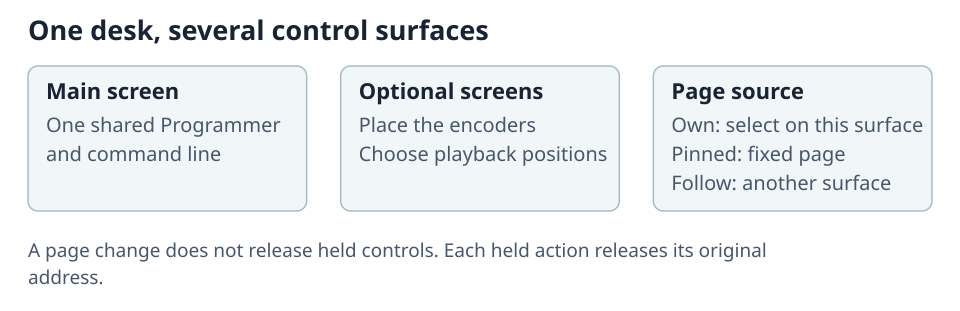

# Screens and Desktop Layouts

Open **Show > Desk Setup > Screens & playback** to configure the main surface and optional desktop screens. Screen settings belong to the desk installation.

## Configure a screen

Name the default screen and choose **Configure Playbacks**. For each row, set **First Playback Number**, **Playbacks in row**, **Input type**, and **Buttons**. Choose its **Page source**, then **Save**.

A **Fader** row controls levels. A **Buttons** row provides only actions. **Potentiometer or encoder** uses a rotary level control: turn or drag it for level, press its centre for the Playback action, or use **Set value** for numeric entry. These are separate from Programmer encoders.

**Enable software keyboard shortcuts** controls the main screen's shortcut layer; attached hardware disables it automatically. Other main-screen changes save immediately. **Undo** in the setup title bar reverses the latest saved change.

### Known windows and desk lock

**Known windows** lists connected and previously connected windows; **This window** marks the current one. Use **Forget window** or **Forget other windows** to remove disconnected records. This does not delete show data or desk settings.

**Configure desk lock** sets the message, unlock control, and optional wallpaper. Choose **Save Lock Configuration**, then use **Show > Lock Desk** when needed.

### Hardware lighting

With hardware connected, **Hardware lighting** controls **LED brightness**, **Gooseneck brightness**, and **Gooseneck color**. Changes apply immediately and are restored on reconnect. On Compact Connect, color runs from blue at 0 to white at 100. A brightness of 0 switches that illumination off.

### Add an optional screen

In the desktop application, choose **Add Screen**. Use its **Configure screen**, **Open Screen**, **Copy browser link**, and **Remove Screen** actions. The browser cannot create native screen windows.

**Configure screen** has **Layout**, **Settings**, **Placement**, and **Playbacks** tabs. Changes save immediately. A failed save remains visible with its reason; correct **Not saved yet** rows before relying on them.

Choose the screen's **Content**:

| Content | Use |
| --- | --- |
| **Desktop** | A configurable pane workspace above the control region. |
| **Controls only** | Encoders or Playbacks use the full height. |
| **Fixed full-screen pane** | One view-only pane fills the workspace. |
| **Fixed left pane / Fixed right pane** | A pane occupies the chosen side at **Pane width (%)**, with controls beside it. |

Fixed panes support **Fixture Sheet**, **Stage - 2D**, **Stage - 3D**, **Cues - Cuelist**, and **Text**. Configure them from the controlling screen. Missing content is reported rather than replaced with another list or file.

**Show Dock** is available only for Desktop content. **Playbacks**, **Page Controls**, **Command line**, and **Programming** configure the controls on that screen. The optional encoder section omits the main keypad, Programmer fader, Delete, and Move tools.

Select a physical display and native fullscreen in **Placement**. With the Dock shown, **Exit fullscreen** is at its top; with the Dock hidden, it is in the upper-right corner. Closing an optional screen closes only that window. Reopen it with **Open Screen**. Closing the main window quits ToskLight.

Keep the main window open and connected: optional screens share its server, session, command line, and selection. A connection error offers **Retry now**.

### Page sources

Each screen uses the same show-owned assignments but can display a different page:

- **Own page** can be changed independently.
- **Pinned page** stays on one chosen page.
- **Follow surface** tracks another named surface. Follow chains cannot loop.

## Encoder placement

Choose **Configure encoder placement**, then **Encoders on** to select the main or an optional screen. **Visible encoders** selects four, five, or six controls, including with attached hardware.

Moving encoders leaves the main command line, keypad, and tools in place. If their assigned screen is closed, use **Use encoders on this screen** to bring them back.

An optional screen with encoders and Playbacks offers an **Encoders / Playback** switch. It starts on Encoders and changes only which control section is visible.

**Compact encoder assignments** adds readouts beside hardware Playbacks. Press a group such as **Int**, **Col**, or **Pos** to select it; press it again for the next page. The readouts themselves do not edit values. This option is off by default.

Playback rows divide the available height according to their controls. All configured rows fit without scrolling. If the area is too small for usable touch controls, enlarge it or configure fewer controls. Edit Solo Regions in a Playbacks pane displaying that screen, or hold the lower **PROG/PLAYBK** control.

## Build task Desktops

Create Desktops for tasks such as Programming, Playback, Patch, or diagnostics, then add the panes needed for each. Layout changes save automatically. Full built-ins provide temporary workspaces without changing a Desktop.

For pane titles, tile sizing, moving, and resizing, see [Desk Interface and Windows](../30-Windows/01-desk-interface-and-windows.md). Fixture positions are edited in Show Patch or Architect, rather than by moving desk panes.
