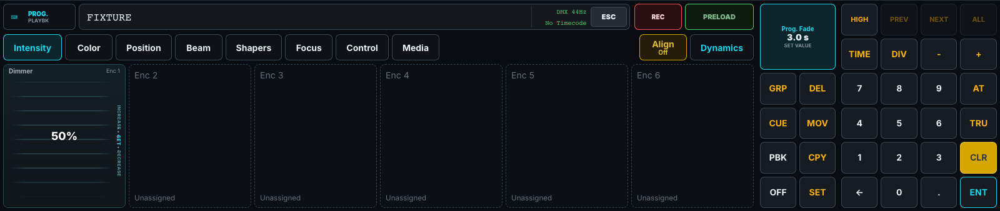
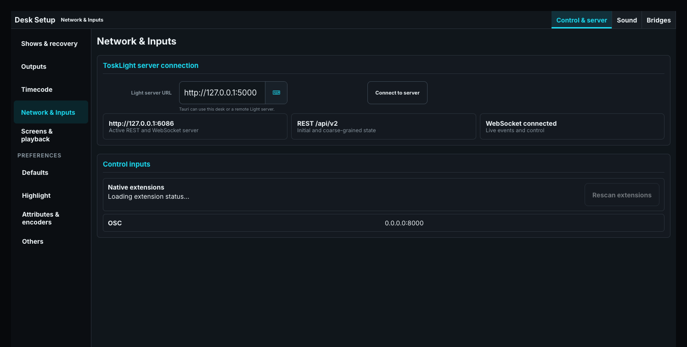

# Inputs, Extensions, and Network Control

Open **Show > Enter Setup > Network & Inputs**. Select **Control & server**, **Sound**, or **Bridges** from the window title. These settings belong to this installation, rather than the portable show.

## Sound-to-Light audio input

1. Open **Network & Inputs > Sound > Sound input**.
2. Request microphone access and allow it in the browser or operating system.
3. Choose the input carrying your audio signal. Use **Refresh inputs** after connecting an interface.
4. Open a Speed Group's settings with Shift-click, Shift-tap, or a hold. Choose its Sound-to-Light source and frequency region, then adjust gain, confidence, smoothing, tempo range, hold, and ratio while checking the signal.

The chosen audio input is local to this browser and shared by Speed Groups A–E. Each Speed Group keeps its own analysis settings. Selecting an input alone does not make every Speed Group follow sound.

## Software keypad

Use the on-screen keypad to enter the same commands as the desk buttons. For a physical computer keyboard, enable **software keyboard shortcuts** on the default screen under **Desk Setup > Screens & playback**. Attached hardware disables those shortcuts automatically to avoid processing a physical action twice.

The [Command Line Reference](../20-Programmer-and-Cues/01-command-line.md) explains the keys and command syntax.

## Native extensions

Native extensions connect supported devices and protocols, including integrations previously handled by built-in MIDI or RTP-MIDI. They are separately installed packages; they are not part of a show.

1. Open **Network & Inputs > Control & server > Native extensions**. Note the displayed **Extensions folder** and configuration-file location.
2. Place the complete extension package in that folder, then choose **Rescan extensions**. Install a complete package rather than replacing individual files while it is in use.
3. Follow the package's setup instructions to edit the reported `extensions.json`: approve its exact manifest ID and locally validated package digest, and configure an enabled instance with its device identity, settings, and control bindings.
4. Restart or rescan as instructed. Check approval, instance health, and any reported device or permission errors before using it in a show.

Approval and instance assignment currently use that file; this page reports their status rather than providing an assignment editor. A package update changes its digest and needs renewed approval. Use a stable device identity, such as a USB serial, so a similar device is not substituted after reconnecting.

Disable an instance in the configuration before removing its package. A failed extension leaves the desk's software controls available. Check platform permissions and the package's driver requirements if a device cannot be opened.

For an upgraded installation, **Diagnostics > Compatibility reports** retains the previous MIDI/RTP-MIDI configuration and removed unsupported MIDI mappings. Use that information when configuring the replacement extension. OSC mappings are unchanged.

## Matter bridge

The Matter bridge exposes assigned Playbacks to a compatible smart-home controller.

1. Open **Network & Inputs > Bridges > Matter bridge**.
2. Enable **Matter server disabled**; its label becomes **Matter server enabled**.
3. Wait for **Ready to commission**, then enter the **Manual pairing code** in your controller. **QR payload** provides the alternative pairing payload.
4. Check the advertised Playback list and test one assignment from the controller.

If the initial commissioning window expires, disable and re-enable an uncommissioned bridge. **Starting Matter networking…** means it is not ready yet; resolve any displayed network or port error before pairing. Disabling stops networking but preserves pairing identity and commissioned controllers.

Assigned **Cuelists** and **Dynamics** appear as dimmable lights; **Group Masters** appear as color lights. Empty positions, Macros, Speed Groups, and timing or Grand Master controls are not advertised. Each light keeps its explicit page and Playback address when the desk changes pages. Assignment changes may briefly restart the bridge while preserving pairing.

For Cuelists and Dynamics, a non-zero controller level starts the assignment; Off or level 0 stops it. Faderless assignments are supported. Group level controls its Group Master. A Group color affects that Group below live Programmer color and above Cue/Dynamic color; reducing the Group Master to 0 does not release the color. The contribution is temporary and clears when another show is loaded or the Group is deleted.

This build uses development Matter credentials. Controllers requiring certified production attestation may refuse pairing. Only one Matter service can use the standard Matter port on a computer.

## Highlight look

Open **Desk Setup > Preferences > Highlight**. Set Intensity and the optional Color, Iris, Zoom, Focus, and Frost values. **Ignore** leaves that attribute's existing look visible. Shutter uses the fixture profile's **Open** function.

The Highlight look is shared installation data. If an older show reports **NeedsReview** or **LegacyRaw**, review the settings before choosing **Use semantic Highlight Look**.

## OSC

**Network & Inputs > Control & server** displays the active OSC binding. Configure that binding in the server installation, then check it here. Use the trusted lighting-network interface.

Desk OSC controls share the visible command line and selection. Remote-control OSC guests operate Playbacks only. Test a harmless selection or Playback before the show. See [OSC Protocol](../../90-Protocols/01-osc.md) for addresses and permissions.

## Remote servers

The desktop normally connects to `http://127.0.0.1:5000`. To operate another server, enter its **Light server URL** and press **Connect to server**. A LAN installation should be protected with a desk token; ask the installation administrator for the connection details.

