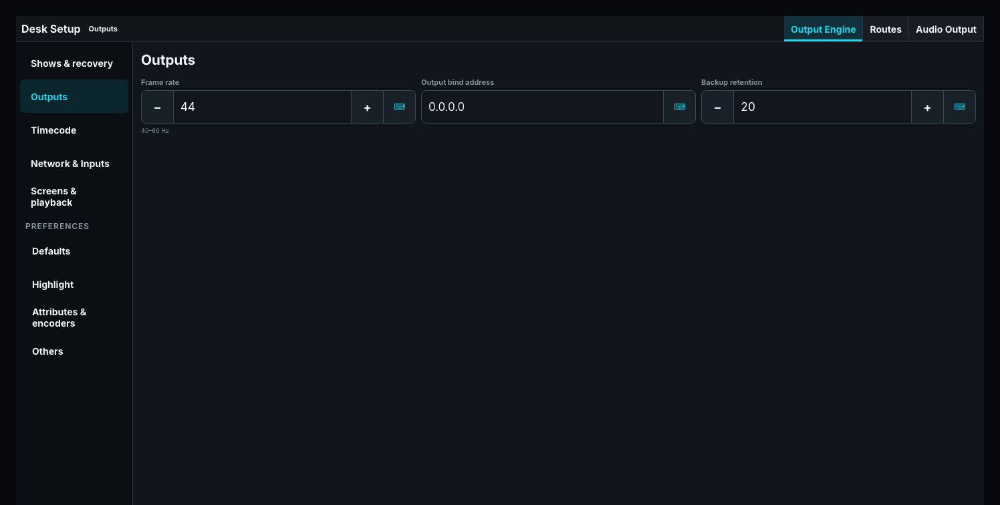

# DMX Output and Universe Routes

A route sends one logical show universe to an Art-Net or sACN destination universe, or a local USB DMX interface. These transports provide output, not DMX input.

## Configure the engine

Open **Desk Setup > Outputs**. Choose a 40–60 Hz frame rate and bind to the interface on your lighting network. On a computer with several network adapters, choose its specific IPv4 address; `0.0.0.0` lets the operating system choose. Save and restart if requested.

Backup retention is also configured here; the checkpoint interval is under **Shows & recovery**.

## Create routes

1. Open **Desk Setup > Outputs > Routes** and choose **Add route**.
2. Select the logical universe patched in your show.
3. Choose the protocol and delivery mode, then enter the destination universe and address where required.
4. Enable and save the route. Use **Edit route** to change it later.

| Delivery | Destination |
| --- | --- |
| Art-Net Broadcast | Broadcast to the lighting network. |
| Art-Net Unicast | The receiving node's IPv4 address and port. |
| sACN Multicast | The multicast address derived from the destination universe. |
| sACN Unicast | The receiving node's IPv4 address and port. |

For example, route logical universe 1 to sACN destination universe 1, or to Art-Net universe 0 if that is what your node expects. Match the receiving device's numbering: the logical universe and destination universe need not be equal.

**Minimum universe size** starts at 128 slots. A fixture extends output through its complete footprint. An enabled route continues sending even when nothing is patched in its logical universe.

Disabling a route stops output and keeps its mapping. Removing it requires confirmation. Art-Net does not send a final blackout when stopped; sACN sends stream termination. Confirm the receiving device's loss-of-signal behavior before relying on either action to make a rig safe.

## Configure USB DMX

1. Connect the interface and choose **Scan USB devices** beside **Add route**.
2. Find the interface by its USB serial identity and choose **Add route for device**.
3. Select ENTTEC USB Pro or Open DMX if the interface type cannot be determined automatically.
4. Assign its logical universe, save, and check that the device becomes **Online**.

ToskLight supports FTDI Open DMX and the documented ENTTEC DMX USB Pro v1.44 framing family. A similar product name does not guarantee compatibility. On macOS, use the recommended `/dev/cu.` connection when a device also offers a `/dev/tty.` path.

The route remembers the exact USB serial where available. An ambiguous or unavailable device stays Offline rather than being replaced with another interface. Check the error and reconnect status if it does not recover after reconnecting.

Test the actual interface before production. USB Pro can retain its last buffered frame after output stops; Open DMX cannot promise a final electrical state on shutdown.

## Verify output

Open **DMX** to inspect slot values and network health:

- **Values** shows the patched channel and its current raw value. A diagnostic override bypasses normal programming; use **Release override** after testing.
- **Nodes** shows configured routes, discovered sources, and their status. **Conflict** means another source sends a universe your desk also sends. Change one source or route before the show.
- With no channel selected, check the measured frame rate, send errors, and change lead time.

Confirm the bind interface, enabled route, delivery mode, universe mapping, and representative fixture movement. A value in the Programmer alone does not prove output reaches the rig.
