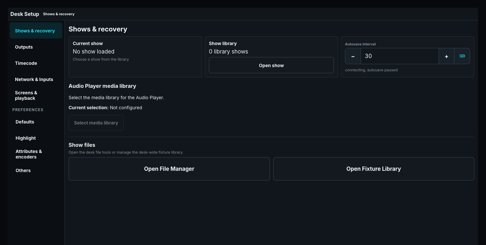

# Surfaces, Sessions, and Recovery

## One desk, many surfaces

The main window, optional screens, connected browser sessions, keyboard, and attached controls share one command line, ordered fixture selection, and Programmer. A command started on one surface can be finished on another. There is no separate Programmer or operator identity to switch to.

## Guest surfaces

In a screen's settings, set **Programming** to **Not editable** for a monitor or guest surface. It can display the rig and run Playbacks, Macros, and Timecodes, but cannot record, update, or assign.

OSC remote-control guests operate Playbacks only. An OSC desk surface has the full desk button set. See [OSC Protocol](../../90-Protocols/01-osc.md) for the connection choices. A guest moving a fader while Record is armed moves that fader; it does not become a Record target.

## Desk Lock

Desk Lock blocks input on every screen and attached control surface. Running output continues. Configure its message, unlock control, and optional wallpaper under **Screens & playback > Configure desk lock**; apply it with **Show > Lock Desk**.

## Shows and recovery

**Desk Setup > Shows & recovery** displays the active show, library, server state, and autosave status.

- Set the recovery checkpoint interval from 5–3600 seconds; the default is 30 seconds.
- **Open show** opens the normal Load Show picker. Choose **Load Latest** or a named revision; loading uses a safe-blackout transition.
- **Open File Manager** opens the desk's file tools.
- **Audio Player media library** chooses the folder used by Internal Audio Players. It also appears as **Audio Library** in File Manager.

Show edits autosave to the portable `.show` file. Named revisions are separate restore points and do not stop later autosaves. Keep both the show files and desk data when backing up an installation.

### Recover a show that will not load

Preserve the affected file before trying repairs. In recovery, the failed show remains named but the desk runs an empty show with no fixture output. It does not overwrite the failed file, and editing that show is blocked.

Load another show, choose **Load Clean Built-in Default**, or choose **Initialize New Empty Show** to resume work. Restore a known revision where available. Keep the original file for diagnosis; see [Shows, Revisions, and MVR](10-shows-revisions-and-mvr.md).

### Shows programmed before fixture-independent programming

Older ToskLight builds stored Pan, Tilt, and Zoom as channel percentages. Current builds store Position and Zoom in degrees and Color as a fixture-independent value, so the same programming can be used across supported fixture types.

A show containing incompatible old values is refused with a list of affected objects; it is not silently converted. Keep the original and open it in its earlier build, or re-record the affected programming with current controls. An Undo or Redo that would restore incompatible values is also refused without changing the current state.

If saved temporary Programmer or Playback state is incompatible, the desk enters recovery and preserves a recovery copy. Load a usable show before continuing. Shows saved by the current build may be refused by older builds; retain a compatible backup before upgrading a production desk.
