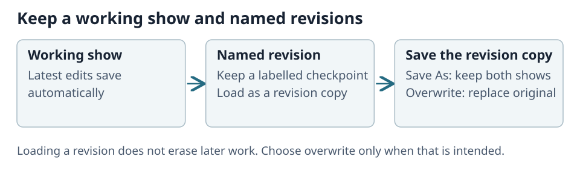
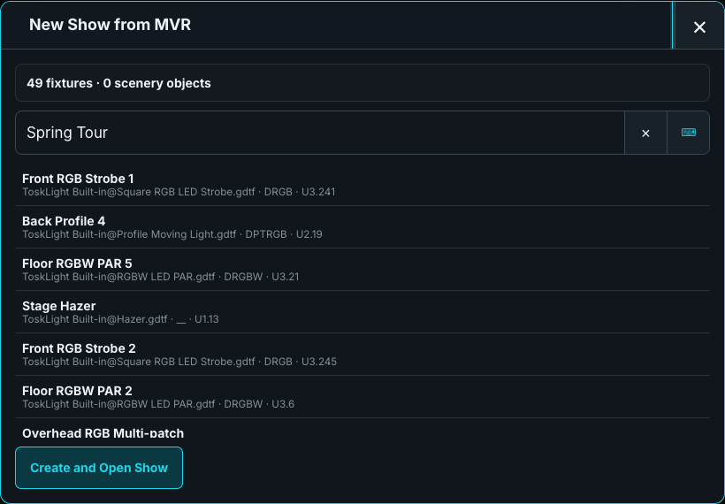
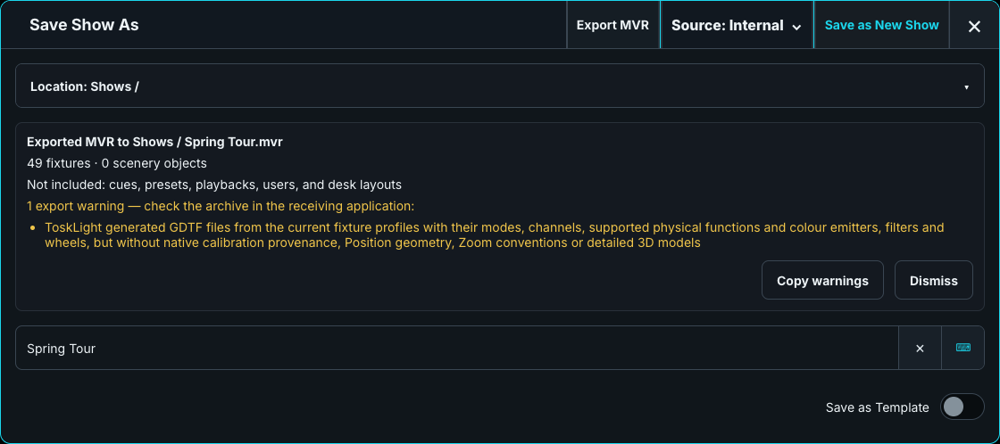

# Shows, Revisions, and MVR

Keep the native **.show** file for programming and recovery. MVR exchanges the rig with other applications; it does not replace the native show or transfer Cues, Presets, Playbacks, users, or desk layouts.

A portable show contains patch, stage layout, Groups, Presets, Cuelists, Playbacks, and other show objects. Desk configuration remains on the installation.

## Create, load, and revise

### Create a show

Open **Show > New Show**:

- **Create Empty Show** starts and autosaves a show named **New Empty Show**. Its first **Save As** gives that same show its final name without losing programming.
- **Load Clean Built-in Default** creates a fresh copy of the supplied demo rig. Changes to an existing Default Stage Show do not change this clean source.
- **Start from a base show** creates an independent copy of a saved template. The base and its revisions remain unchanged.
- **Load from MVR** imports a rig; see [Import MVR](#import-mvr).

To make a reusable base, enable **Save as Template** when saving. **Edit description** adds the description displayed in New Show.

### Load a show

1. Open **Show > Load Show**.
2. Choose **Internal**, a connected **USB** drive, or **Network** from the title-bar Source menu.
3. Browse folders and choose **Load Latest** beside the show. **Up one folder** returns to its parent.

**Network** lists available shows from other desks and Architect instances. Loading creates an independent local copy; later changes on either side are not synchronized.

Use the show's **…** action to open its revision table. **Latest Autosave** is the newest work; named revisions follow below. **Partial Load** previews dependencies and conflicts without activating the source show.

### Save a copy

In **Save Show As**, choose the destination with the Source menu. Click **Location** to browse folders, select a writable folder, and enter the name. USB drives appear directly in the Source menu; Network offers available destinations.

Saving a portable copy leaves the active show and named history intact. An existing destination file is refused rather than silently overwritten. The first naming of a provisional **New Empty Show** keeps its identity, as described above.

### Keep restore points

Choose **Save Named Revision** before important changes. It creates an immutable, numbered restore point while normal work continues autosaving.

**Load Revision as Copy** activates a separate show made from that revision. Its name identifies the source and date; the Show menu also shows its revision details. Later work autosaves to the copy, leaving the source's Latest Autosave and revisions unchanged. The copy remains in the library after restarting.

## Save a revision copy

Saving a revision copy offers **Keep as Separate Show** or **Overwrite Original Show**. Overwriting replaces the original's Latest Autosave after confirmation and a recovery backup; it keeps the original identity and named revisions. If the original was deleted, that choice is unavailable.

For an established show, selecting an existing show as the Save As destination also requires destructive confirmation. Cancel leaves both shows unchanged.

## Load from a Visualizer on the network

A networked Architect/PreViz Rig Editor with a show open can offer it through **Load Show > Load from Visualizer**. Choose the named editor and document to import and activate a local copy.

The offer requires discovery and network access. If it is absent, check that the editor has a document open and the firewall allows discovery. The transfer is a copy, not a live link. See [Planning and Transfer](../../20-ToskLight-PreViz/06-planning-and-transfer.md) for the reverse direction.

## Import MVR

1. Choose **New Show > Load from MVR** and select the archive.
2. Review fixture profiles, selected modes, missing profiles, and address conflicts.
3. For each conflict, choose a safe address, **Import unpatched**, or skip the fixture. Unpatched fixtures stay in the show but send no DMX.
4. Apply only after checking the preview.

Embedded GDTF profiles use the Fixture Library importer. If a native profile conflicts with an existing immutable revision, **Import conflicting profiles as new identities** keeps separate copies rather than overwriting the library. Review calibration again when a fixture's profile identity changes.

Fixtures retain their named patch layers. Missing profiles remain unresolved and need attention before use; additional DMX breaks may remain unpatched. Standalone scene geometry is not imported: recreate required scenery with Venue fixtures. The supported operator workflow creates a new show rather than merging into an existing one.

## Export MVR

1. Open **Save As**, choose the destination folder, and enter the export name.
2. Choose **Export MVR** in the title bar.
3. Read the saved archive's summary and warnings. Use **Copy warnings** when handing the file to another team.

MVR carries fixture identities, patch layers, positions, orientations, and supported fixture profiles. Visual-only Venue objects are included as fixtures. It does **not** carry Cue programming, Presets, Playbacks, users, or desk layouts.

Where possible, export reuses the original GDTF; otherwise it generates one from the current fixture profile. Generated profiles can omit detailed geometry, calibration information, or unsupported features. Another application may also interpret hanging brackets and models differently. Read the specific warnings and inspect the rig in the receiving application before relying on the transfer.

Keep the native `.show` file and named revisions as your programming and recovery source.

## New Show and reusable bases

Use **Save as Template** to make a library show available under **Start from a base show**. Choose **Create show** beside it to work on an independent copy. Its portable description is copied too. Editing the new show never edits the base or its named revisions.
