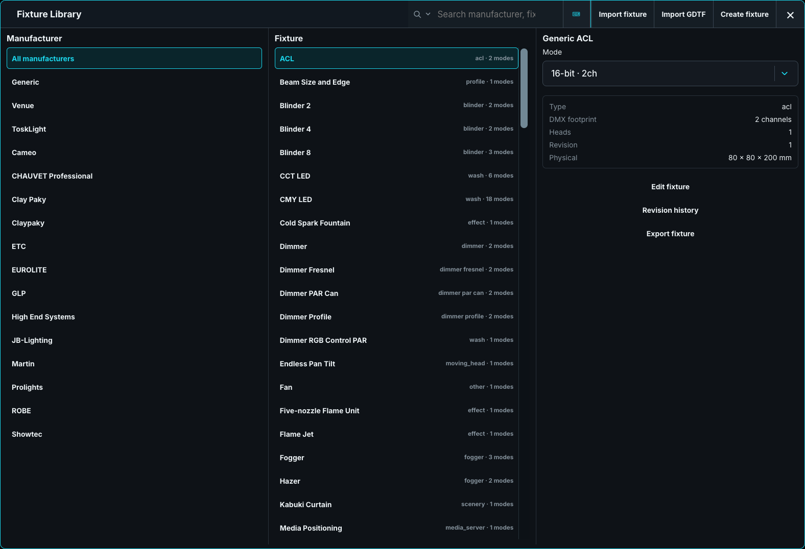
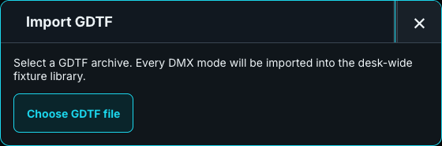
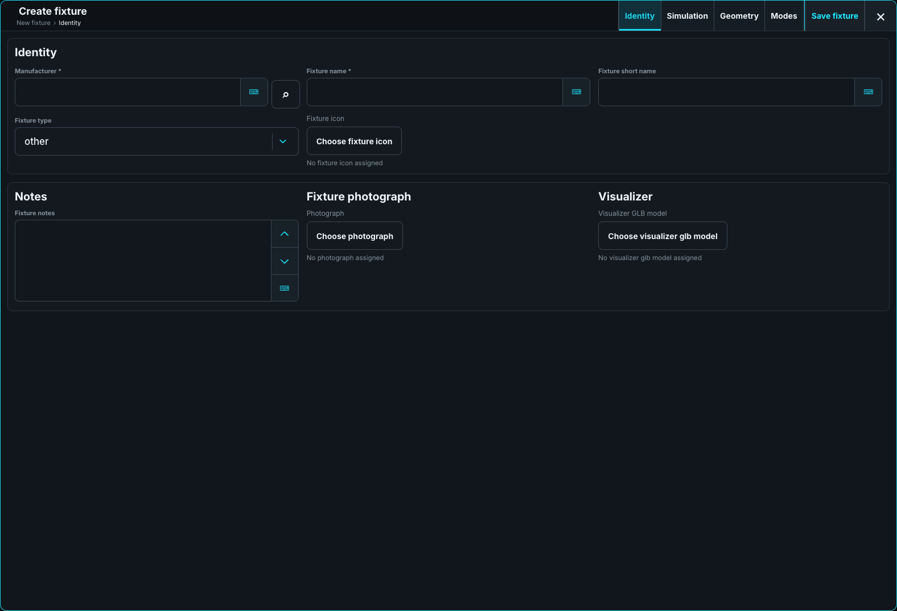
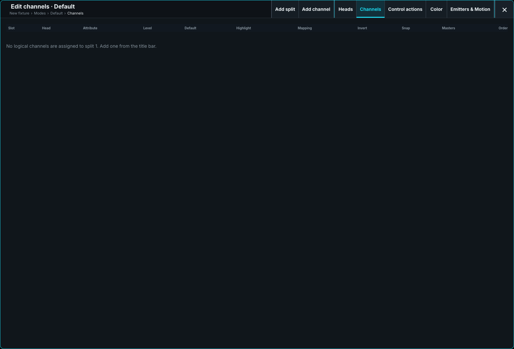

# Fixture Types and GDTF

Choose the exact fixture **profile revision and mode** before patching. Each show embeds its selected revision, so later library edits do not change an existing rig.

Open **Desk Setup > Shows & recovery > Open Fixture Library** to search, import, create, or revise a profile. Search filters as you type; its Options selects the fixture type.

Use **.toskfixture** to transfer a complete ToskLight profile, **GDTF** to import a fixture description, and **MVR** to exchange a rig. A color or beam prediction is an aid to programming; verify the real fixture before a show.

## Transferable fixture packages

Select a fixture and choose **Export fixture**. Choose its **Destination**, folder, and **File name**, then **Save fixture package**. An existing file is not overwritten. On another desk, choose **Import fixture** and select the `.toskfixture` file.

The package includes the complete profile revision, modes, and assets. Importing identical content changes nothing; a corrected package for the same fixture creates a new local revision. Keep its identity when correcting a fixture, rather than reusing it for a different product.

Choose the profile matching the physical lantern: a PAR, Fresnel, and profile spot can have the same dimmer channels but different models. For manufacturer fixtures, check every mode against the fixture's own menu and DMX chart.

The shipped Generic ACL keeps a narrow concentrated core with a soft fading field. Its edge is a nominal preview, not measured photometry; shows keep their embedded revision until explicitly updated.

### Generated Venue objects

Trusses, curtains, decks, stairs, and other generated Venue objects use the size set for each placed object. Edit the available **Footprint width**, **Footprint height**, and **Footprint depth** in Show Patch or Architect; unavailable dimensions show a dash. **Colour** changes its material and **Default colour** restores it. **Scale** resizes supported objects, including imported models.

For a Chain, choose **Plain chain**, **Motor on top**, or **Motor on bottom**. Stage decks and stairs are positioned by their feet; most other objects use their centre. See [Stage Positions and Scenery](13-stage-positions-and-scenery.md) and [Architect planning](../../20-ToskLight-PreViz/06-planning-and-transfer.md) for placement.

These visual-only objects have no DMX footprint. Existing shows keep the fixture revisions embedded in them.

## Import GDTF

Choose **Import GDTF**, select the archive, and review its modes, channel footprint, and import limitations. Map any unknown attributes, then choose **Import fixture** or **Import and remember mappings**. An import error leaves the original data unchanged.

The importer retains the original archive with the profile. MVR export reuses it only while it matches the profile being exported; otherwise it generates a supported GDTF and reports limitations. Retained source data does not mean the fixture has been measured. The library does not export standalone GDTF files.

## Create or edit a fixture profile

Choose **Create fixture** for a blank profile, or **Edit as new revision** for a correction. The editor's title bar contains **Identity**, **Simulation**, **Modes**, and **Save fixture**. Saving an existing profile asks to **Save and create revision**; an error keeps the draft open. Closing a changed draft asks whether to **Stay** or **Discard changes**.

Use the manufacturer's documentation for channel functions, limits, and safe defaults. The following is an editor guide; detailed package and model authoring belongs in the repository's fixture-author documentation.

### Identity

Set manufacturer, full and short names, fixture type, notes, icon, photograph, and optional GLB model. The manufacturer lookup reuses a library name. Drag the model preview to inspect it and scroll to zoom.

### Simulation

**Body** chooses the appearance. **Physical** holds dimensions, weight, power, connectors, and light-source details. **Optics** holds color temperature, output, beam angle, and beam appearance. Leave optional optics fields empty to use the fixture type's default appearance.

| Field | Entry |
| --- | --- |
| Width, Height, Depth | Whole millimetres |
| Weight | Kilograms, up to two decimals |
| Power consumption | Whole watts |
| Sharpness, Uniformity | Percent, one decimal |

Invalid precision is shown beside the field and blocks saving rather than being rounded.

Choose a **Generic body** when the default shape is unsuitable. The searchable picker shows the bodies listed in the [Model Catalogue](../../99-Appendix/01-model-catalogue.md). A supplied GLB takes precedence.

**Mounting** defines how Architect attaches the lamp to a truss. Set **Hangs by** and the clamp's pipe position and dimensions in whole millimetres from the body centre. Use the actual hardware; a floor-standing fixture should not acquire a truss clamp.

### Modes and heads

Add modes from the title bar and reorder by dragging. **Edit channels** opens **Heads**, **Channels**, **Control actions**, **Color**, and **Emitters & Motion**. The breadcrumb below the title returns to an earlier editor.

Heads are independently controllable sources, such as pixels or wash zones. At most one head is the shared master. Reassign a head's channels before removing it.

Splits are separately patched address blocks. One head may use several splits; each split receives its own optional address in Show Patch. An unpatched split remains programmable and visible but sends no DMX.

### Channels

Enter slots in the order printed in the DMX chart. Touch a cell to edit it.

| Column | Use |
| --- | --- |
| **Attribute** | Choose the desk control, or Static for a fixed output. |
| **Level** | Coarse for the first byte, Fine for the second, then Ultra and Extreme where needed. |
| **Default / Highlight** | Set safe raw home and identification values. |
| **Mapping** | Set physical endpoints and named functions; **Details** edits function-specific values. |
| **Invert / Snap** | Reverse the mapping or make it jump instead of fade. |
| **Masters** | Inspect level behavior and set **React to Virtual Intensity** where appropriate. |

For 16-bit Pan, assign Pan to two slots and make the second **Fine**. It must refine a matching coarse channel on the same head. Settings belong to the coarse row; additional bytes show a dash.

A head without a physical dimmer can use virtual Intensity. Its additive emitters normally **Follow** that intensity; emitters with a physical dimmer normally **Ignore** it to avoid dimming twice. **Inverse** gives the opposite response. Check the actual fixture before changing these controls.

**Add split** and **Add channel** are in the title bar. Drag slot handles to reorder them; removing a slot requires confirmation. **Static output** sends its Default normally and its Highlight value while Highlight is active. Typed Lamp, Reset, and Fan commands belong under **Control actions** rather than recordable values.

### Physical mapping calibration

For a Continuous function, open **Mapping > Details**. Enter its physical range and evidence quality. **Manufacturer** and **Measured** require a source; Zoom can identify **Beam angle** or **Field angle** when documented.

Use **Use sampled mapping** for a measured non-linear response, then **Add intermediate sample**. Raw samples must increase and physical values must progress in one direction. **Use function endpoints** repairs the endpoint samples; **Use linear mapping** removes intermediate samples. Invalid data blocks saving. This editor calibration currently supports the profile and preview, not live output or Stage simulation.

### Color

Configure a separate color system for each independently controlled head. **Copy to other heads** copies it to compatible heads while leaving unmatched heads unchanged.

Choose **Measured**, **Nominal**, or **Uncalibrated** honestly, with source and revision information. [Color Intent](../20-Programmer-and-Cues/05-color-intent.md) uses this information when reporting approximations.

For a wheel, **Fill slots from wheel functions** creates its named positions without replacing defined colors. Set each slot's display color and whether it is a valid **Steady colour for Color Intent**. Split, scroll, and rotation effects should not be offered as steady colors. Use **Control > Special Dialog > Generate portable presets** to make fixed choices available in the show.

### Physical optical paths

**Create physical path** starts a head's physical color model from its controls. Include the actual emitters, filters, wheels, and functions in their light-path order. Unknown measurements must remain Unknown; a missing measurement is not zero output.

These paths affect live Color matching. Changing referenced channels can invalidate the path and block saving, so review it after channel edits. Updating a model does not rewrite stored Preset or Cue color intent. Detailed optical measurements should be entered by a fixture author using verified data.

### Installed Position calibration

For an individual installed lamp, use **Show Patch > Pan / Tilt > Position calibration…**. Enter signed **Pan zero offset (°)** and **Tilt zero offset (°)** with quality, source, and revision. **Clear calibration** removes this instance's correction; it does not edit the library profile.

Each multi-patch copy has independent calibration. These offsets change both the DMX aiming and the Stage beam. Mounting rotation and Pan/Tilt inversion are separate settings.

### Emitters & Motion

Bind each mode's logical heads to the fixture's emitters. Under **Moving parts**, choose the channel driving each part, or **Not driven**. This lets one mode control all wash rings together while another controls them separately, using the same physical model.

## Geometry

Geometry describes the fixture once, across all its modes. Use the part list, properties, and preview to check the body, emitter faces, and pivots. The preview shows the lamp without beams; inspect the light on Stage.

A part's **Generic**, **Translation**, **Rotation**, **Scale**, **Pivot**, and **Animate** tabs describe its construction. **Animate** sets its motion axis, range, and optional travel speeds; the mode's **Emitters & Motion** chooses the driving channel. Leave speed limits empty for immediate simulated movement.

## Revisions and compatibility

**Revision history** lists immutable revisions. Edit an older revision as a new one rather than overwriting it. A show already patched to a revision keeps its embedded copy when the library changes or that revision is deleted.

If an upgraded library reports a migration conflict, retain the original and review the warning before deleting anything. User revisions are preserved when an updated shipped package would replace an operator-edited version.

## GDTF import preview and retained source

The preview identifies supported data, limitations, and unknown attributes before import. Unsupported relationships may stop import with an explanation. Keep the source archive when resolving a problem.

The retained GDTF travels with exported `.toskfixture` packages and embedded show profiles. After editing a profile, inspect MVR export warnings: the exported GDTF may be generated rather than reused. See [Export MVR](10-shows-revisions-and-mvr.md#export-mvr).

### Installed Color calibration

In Show Patch, use **SET** or the context menu on a physical fixture's **Light source** cell. Open its calibration action; with no Stage geometry emitter, choose **Color calibration…** directly.

Enter measured emitter output gains or whole-path color observations with their native recipe and evidence. These controls record observations; they do not send that recipe to the lamp. Gain 1.0 keeps profile output and 0.0 means no output, rather than an unknown value.

Each physical instance has independent observations. Replacing a fixture or changing an incompatible profile retains old observations as inactive; review or clear them before recalibrating. New duplicates have no installed Color calibration. Compatible observations are used for live Color fitting. Stored
Preset and Cue Color intent stays unchanged.

## Physical geometry and individual axis calibration

Use **Geometry > Declare physical geometry** for verified axis and bracket measurements, and **Emitters & Motion > Configure physical Position** to bind native Position functions. Absolute motion uses degrees; continuous speed uses degrees per second.

In **Pan / Tilt > Position calibration**, individual axis overrides replace that axis's zero and direction. They belong to this physical lamp and its profile; incompatible replacements leave them inactive. **Clear axis overrides** removes them while keeping the family offsets. Verify DMX and aiming after calibration.

### UV emitter data

Mark a physical optical-path emitter as **UV effect** and bind its UV function. Visible color measurements do not measure UV strength or predict fluorescence. Leave unknown visible output unknown; do not substitute purple for ultraviolet.
