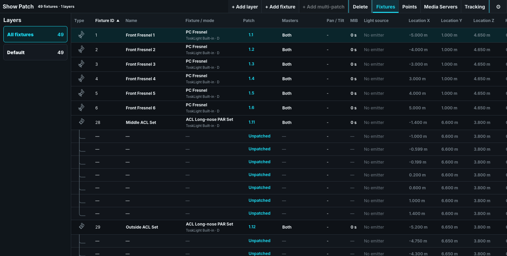
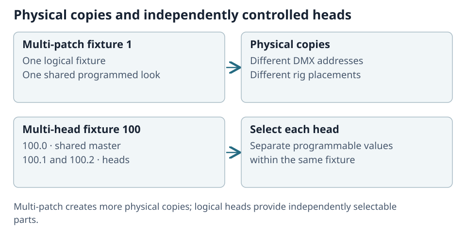

# Patch Fixtures and Scenery

Open **Show > Show Patch** to connect fixture IDs to profiles, modes, and DMX addresses. Placement describes where the installed object appears on Stage; it is separate from programmed Pan/Tilt.

## Patching Fixtures

1. Choose **+ Add fixture**. Search for the manufacturer, product, and exact mode, then check its footprint.
2. Set **Start fixture ID** and **Count**. Used IDs are skipped while preserving the requested count.
3. Choose **Address** and enter the starting `universe.address`, or **Empty** to add unpatched fixtures.
4. Check the proposed ranges in the 512-slot grid and choose **Add fixtures**.

The blue proposed ranges can be dragged separately; a red range overlaps or does not fit. Existing fixtures stay protected. **Cancel** leaves the patch unchanged; a changed placement draft asks before closing.

The patch command `<amount> [AT] <universe>.<address>` adds a consecutive run at the mode's footprint spacing. Chain runs before `[ENT]` for different addresses or universes.

Unpatched fixtures retain selection, programming, Groups, and Cue data; they simply send no DMX. To repatch, press **SET** and touch the address cell. **Clear address · Unpatch** clears that address.

For a multi-split mode, **Independent split patches** provides an address for each block. Leave a field empty to keep that split unpatched. Batch placement advances each split by its own footprint. All addresses are checked together, including multi-patch copies; an invalid change is refused without a partial patch.

Venue scenery uses reserved `0.x` IDs and has no DMX address. It appears in Patch and Stage, rather than the Fixture Sheet. Place separate Venue objects for separate physical pieces.

Click a table header to sort; click again to reverse it. Shift ranges follow that displayed order. Use **Settings > Columns** to hide columns; at least one remains visible.

## Importing a CSV Patch List

Open **Show Patch > Settings > Import CSV**. Import adds fixtures without changing existing ones.

1. **Columns:** select a comma-, semicolon-, or tab-separated file. Choose whether it has headings and whether positions use metres or millimetres. Map its patch, fixture ID/name/type, manufacturer, mode, position, and rotation columns; ignore unused columns.
2. **Fixture types:** confirm each manufacturer's product and mode. Exact unambiguous matches are suggested. Select a profile for unmatched rows, or choose **Skip these rows**.
3. **Review:** check the proposed fixtures and choose **Import**. They are added on the selected layer, or Default when all fixtures are shown.

| CSV value | Rule |
| --- | --- |
| Patch | `universe.address`, `universe/address`, or absolute address; 513 means 2.1. Empty or `-` means unpatched. Only the first split is addressed. |
| Fixture ID | An unused whole number; Venue objects use `0.x`. Empty chooses a free ID. |
| Name | Empty uses the product name and ID. |
| Position / rotation | Empty means 0; rotation uses degrees. Decimal commas are accepted. |

Address conflicts import unpatched by default, or can be skipped. Unusable rows appear as **Not imported** with their reason and do not block valid rows. Review the result before output testing.

## Position Reference: hanging things on a 3D Point

A **ToskLight > 3D Point** is a movable reference for lights and scenery. Program its **Point X/Y/Z** in metres and **Point Rot X/Y/Z** in degrees.

When the show has a Point, **Position Reference** appears in Patch. Use SET or the cell's context menu to choose it for a fixture or Venue object. Moving or rotating that Point then moves everything referencing it. **None** returns the object to stage-relative placement. Points cannot reference one another.

Stage and the Visualizer show the live movement. Architect's CAD keeps the installed plan position and marks **Follows 3D Point**. Removing a referenced Point returns hung objects to their stage placement; aim programming retains a **Missing point** reference until you choose another.

Points can remain unpatched for desk-only use. Their optional Position/Full 16-, 24-, and 32-bit modes send position, and in Full modes rotation, to external equipment. Check that equipment's mapping before connecting motion control.

## Show Patch views

The top-right tabs are **Fixtures**, **Points**, **Media Servers**, and **Tracking**. **Settings** opens settings for the current view. For tracking setup, see [Tracking with PosiStageNet](15-tracking-with-posistagenet.md).

## Points

**+ Create Point** in **Points** adds an unpatched aim Point at the origin. The Position encoder's **Create Point** opens the same view. Rename it, set its resting **X/Y/Z** in metres, and inspect its patch and tracking binding here.

Change its fixture ID or address in **Fixtures**. Delete asks for confirmation. Programming aimed at a deleted Point remains marked **Missing point** rather than silently choosing another target.

## Patched Media Servers

**Media Servers** lists each patched server's type, protocol, IP address, CITP port, and connection state. Choose **Apply** after changing its endpoint, then **Check connection**. **Off** pauses network control without deleting the fixture.

**Refresh Thumbnails** reloads one server's media. **Start live preview** shows its output. If library images are stale, use **Settings > Media Servers > Clear Thumbnail Cache**, then refresh the affected server.

## Discovering a ToskLight Pixel Media Server

Choose **Refresh Discovery** to find local Pixel outputs. Each card shows the server/output name, endpoint, personality, address, and receiving protocol/universe. Discovery alone does not patch anything.

- **Patch suggested** creates or updates the desk fixture to match the discovered output, including its CITP endpoint. It does not change the server.
- **Patch address** chooses another desk address and updates both the desk and server. Add an enabled network output route first so that universe can reach it.

| Status | Action |
| --- | --- |
| **Patched** | Desk personality, address, endpoint, and route match. Test output. |
| **Mode differs / Endpoint differs / Address differs** | Read the mismatch; use Patch suggested or Patch address as appropriate. |
| **Not received** | Check the fixture address and add the required output route. |
| **Needs update** | Update Pixel or select a supported 2- or 8-layer personality there. |
| **Unavailable** | Check server connectivity, then Refresh Discovery. |

A failed remote change reports whether the desk restored its previous patch. Refresh Discovery if either side may differ. If the server requires a restart, that status stays visible. When a formerly patched output is removed, repatch the correct output rather than expecting controls to choose another automatically.

For third-party desks, Pixel offers personality downloads under **DMX > Connect to Console**. Patch consecutive Layers followed by their Master as described there.

## Fixture output and placement settings

Use **SET** or the relevant cell's context menu:

| Cell | Use |
| --- | --- |
| **MIB** | Off or a Move in Black delay. **0 s** enables MIB without a delay. |
| **Masters** | Choose Group Master, Grand Master, Both, or Not controlled. Bypassing a master is an intentional live-output exception; Blackout and safety suppression still apply. |
| **Pan / Tilt** | Invert either physical axis, independently for each multi-patch copy. This does not rewrite stored Position. |
| **Light source** | Choose the installed lamp, color temperature, output, and gel. Empty output inherits the profile. |
| **Location / Rotation** | Set installed position and orientation for Stage. |

Choose **Open Stage Renderer** for visual feedback. Close the renderer when it is not needed. Highlight is configured under **Desk Setup > Preferences > Highlight**, rather than in the ordinary Patch table. If an older show reports legacy Highlight data, review that setting before choosing the semantic look.

## Replace a physical fixture

In Control, use **SET > Fixture / mode > Replace fixture with another product**. Choose the replacement mode and map each existing logical head to its replacement. **Leave unmatched — keep dormant programming** preserves data that the new fixture cannot use.

For shared heads, review destination owners separately for each programming family. Keep the fixture number, placement, and programming, but check the new capabilities and footprint before **Set**. New splits start unpatched; removed splits stop output. An overlap rejects the whole replacement. If the show changed during editing, reopen and review the choice again.

Calibration tied to an incompatible profile remains stored but inactive. Recalibrate the installed hardware, save/reopen, and inspect emitted DMX. Colors may be approximated by the replacement and unsupported attributes remain dormant. Architect's same-product mode editor is a separate workflow.

## Multi-patch

Multi-patch gives one logical fixture extra physical instances that always share programming. Each copy has independent addresses, placement, and Pan/Tilt inversion. Use **Multi-patch Address** to repatch a copy and **Set Address** to confirm it; other copies remain protected from overlap.

Use separate fixtures or logical heads when individual selection is required. Venue objects do not use multi-patch: place each deck, truss, curtain, or stair separately.

## Multi Head Fixtures

A multi-head fixture has independently controlled sources, such as LED pixels, wash zones, or PAR-bar lamps, patched as one product.

For fixture 100, shared controls use `100.0`, and individual heads use `100.1`, `100.2`, and so on. `100 [ENT]` selects the master and all heads; `100.0 [ENT]` selects only the master.

A bare range such as `100 [THRU] 110 [ENT]` selects controllable heads without their masters. Use `100.0 [THRU] 110.0 [ENT]` for the masters. The Fixture Sheet shows separate subhead rows rather than an additional aggregate row.

## Patch check

Check footprint and channel ownership in **DMX**, set a safe test value, and verify the real fixture. Save a named revision before a large repatch or replacement.
