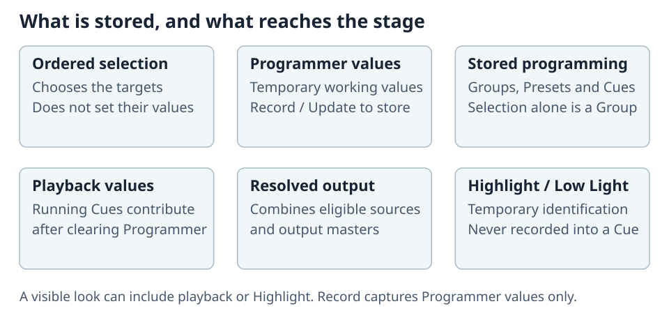

# Selecting and Setting Values

The Programmer holds temporary selection and values. Record or Update stores programming in the
show; a visible playback look is not automatically part of the Programmer.

## Select fixtures and set values

Select from Stage, Fixtures, Groups or the command line. Selection order controls spreads. Use
Thru, Plus, Minus and Division for ordered ranges/subsets; see the
[Command Line Reference](01-command-line.md).

Use **AT** for intensity, recall a Preset, or turn attribute encoders. Enter a range such as
`0 THRU 50` to spread evenly across the selection. Extra THRU points form a shaped spread:
`100 THRU 0 THRU 100` across six fixtures produces `100, 50, 0, 0, 50, 100`.
There cannot be more control points than fixtures.

Encoder value dialogs accept the same spreads in the displayed attribute's units. Stepped controls
show names such as **Shutter open**; continuous ranges show values. Different selected values
read **Mixed**. Position uses Pan/Tilt angles or a target point with X/Y/Z offsets; the first edit
switches mode from the currently resolved pose rather than jumping to a default.

## Align future encoder changes

Select fixtures in the intended order and choose **Align → Left, Right, Out or In**. The next
encoder movement applies these weights to each fixture's own starting value:

| Mode | Distribution |
| --- | --- |
| **Left** | None at the first fixture, full movement at the last. |
| **Right** | Full at the first, none at the last. |
| **Out** | Full at both ends, none at the centre. |
| **In** | None at both ends, full at the centre. |

With an even selection, both middle fixtures share the centre weight. One fixture receives full
movement in every mode. With two, Out moves both and In holds both. Limits and wrap rules still
apply. Align without a selection stays Off.

Changing mode re-anchors at the current values. Moving another logical encoder turns Align off.
Off, Escape, Clear, Record, Preload and Preload GO also end it without reverting the result.

## Highlight and step through

Select fixtures, then press **HIGH** or Alt+H. This freezes the ordered set for identification:
all members start at full white, without storing those values in the Programmer.

| Action | Result |
| --- | --- |
| **NEXT / Alt+Right** | Step forward; wrap after the last fixture. |
| **PREV / Alt+Left** | Step backward; wrap before the first. |
| **ALL / Alt+A** | Select and Highlight the whole original set again. |
| **HIGH** again | Remove Highlight/Low Light and reveal underlying programming. |

In Step mode, the focused fixture is highlighted; the rest use Low Light (10%, blue). Value edits
write only the focused fixture. In All mode they write the whole original set. An explicit edit
replaces that attribute's temporary look and stays in the Programmer as you move to another step.
Other Highlight attributes remain temporary.

Later Group edits or selections do not grow the frozen set; deleted fixtures are skipped.
Multi-patch copies share one logical step item. The Fixture Sheet keeps the original set visible
and marks the active step. Highlight is never recorded into a Cue/Preset and is not restored by
reopening a show. Blind/Preload suppress its live look. Normal fixture limits and output controls
remain effective.

## Clear and undo

Press **CLR once** to clear selection. A blinking Clear indicates values remain; **CLR again**
clears them. Undo covers programming changes, not live playback execution or fader movement.

Every editable surface uses the desk's shared Programmer. A Not Editable screen or a remote
playback surface can operate playbacks without editing it. See
[Surfaces, Sessions, and Recovery](../10-Show-Setup/05-users-sessions-and-recovery.md).
