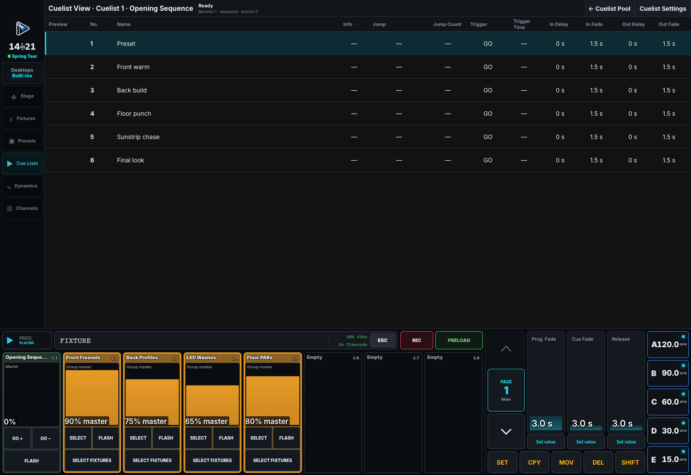

# Cues and Playbacks

A **Cuelist** stores ordered Cues. A **Playback** is a control assigned to that list, a Group or a
special master. Clear the Programmer (**CLR twice**) before proving playback on its own.

## Assign controls

Press **Shift+SET**, then choose a Playback to open its configuration. Or choose the source first,
then the destination: **Shift+SET → Group/Cuelist → Playback**. A regular SET edits, rather than assigns.

| Tab | Configure |
| --- | --- |
| **Function** | Playback type and target, then name and colour. **None** clears the assignment without deleting its target. |
| **Behavior** | Auto-off, temporary release behavior and Swap protection. |
| **Layout** | Available button, fader and push-encoder functions. **Empty Button** leaves one unassigned. |

**Apply** saves the draft; Close discards it. Changing type loads its standard control layout.
A Cue List normally uses Go Minus, Go Plus, Flash and Master; a Group Master uses selection,
dereferenced selection, Flash and Master. Fade masters provide Double, Half, Off and a time fader;
Off sets their time to zero.

### Auto-off and temporary controls

These Behavior settings are independent. Cuelist choices affect every Playback assigned to it.

- **When fader reaches zero** turns the list Off at Master zero. Raising it resumes the same Cue
  only when that zero gesture caused the Off. Temp and X-fade endpoints do not trigger it.
- **When Flash is released** turns it Off only if that Flash started an otherwise Off list.
- **When Flash or Swap is released** chooses whether temporary release also removes retained
  non-intensity state.
- **Turn off when other playbacks take full control** requires complete replacement by normal
  full-level playbacks; partial, Flash and Temp takeovers do not count.
- **Protect from Swap** retains this Playback's level while another Swap is held.

**Preferences → Defaults** supplies initial Auto-off choices and **Start after first recording**;
changing defaults does not rewrite existing lists. If first-record start is enabled, creating a
Playback/list/first Cue starts it at full and clears the recorded values while retaining selection.
Adding later Cues or recording into an existing empty list does not auto-start.

## Manage pages

Touch **Page** to choose an existing page. Its keyboard icon renames without selecting.
**Add new page** creates/selects the next page. Next Page also creates one when the last page is
occupied, but does not keep adding empty pages.

For the current page, **SET → Page → Rename Page** changes its name. Names and assignments are
stored in the show; each independently paged surface keeps its own position. Check the selected
surface's effective page before entering an undotted Playback number.

## Run Cues

| Action | Result |
| --- | --- |
| **GO** | Run the next Cue, or resume a paused transition. |
| **GO minus** | Reconstruct and run the previous Cue. |
| **Pause / Resume** | Freeze/continue the current transition without advancing. |
| **Release** | Remove this Playback's ownership, exposing underlying sources. |
| **Flash** | Play temporarily with Cue timing while held. |
| **Temp** | Temporary playback toggled by one press on, another off. |

An interrupted fade starts the new transition from the current output. Incoming values use the
entered Cue's In timing; decreasing/released Intensity uses the left Cue's Out timing. Stored
per-value timing wins unless Force Cue Timing is on. See
[Programming Cues](04-programming-cues.md#which-cue-owns-the-timing).

Flash/Temp still run Follow and Time triggers. A list that releases all parameters turns itself
Off after those releases finish, also ending its Flash/Temp. This does not apply to an empty,
paused or chaser list, or one still holding Group values or running Dynamics.

### Jumps, selection and order

Set a Cue's **Jump** destination and positive **Jump Count** for a counted loop. Each arrival
uses one Jump until its count is exhausted, then the next GO continues normally. Off/restart resets
the counts. Go To navigation past a Jump resets it without taking it. Renumbering keeps destinations.

Running another Playback does not change the explicitly selected one. **Cuelist View** shows its
current/next Cue. Touch a pool preview to enlarge it. **Cuelist Settings → Renumber Cues** numbers
consecutively from **First new Cue number** without changing Cue order or contents.

Recording on touch uses the visible Playback area; hardware uses its topmost button, or its
on-screen section if buttonless. The fader remains live. See
[Record targets](01-command-line.md#recording-the-first-cue).

**First / Continue**, looping and chaser settings determine starts and end-of-list behavior.
Rehearse the actual production policy after a restart.
