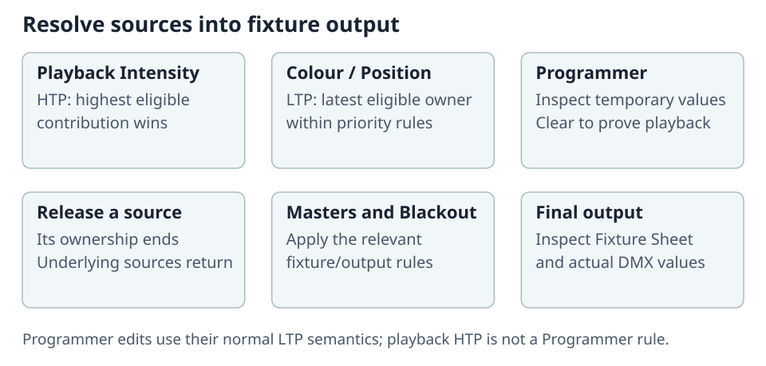

# HTP, LTP, and Ownership

ToskLight resolves several active sources into one output value per fixture attribute.

## HTP

Playback Intensity normally uses Highest Takes Precedence. The highest contributing level wins, so bringing up another intensity master cannot reduce a higher active source. Releasing the winning source reveals the next-highest contribution.

## LTP

Latest Takes Precedence is normally used for color, position, beam, and other non-intensity playback attributes. Programmer edits use LTP semantics, including Intensity. The most recent eligible owner wins within priority rules. Temporary Flash/Temp actions restore the prior LTP owner when released rather than leaving their last value behind.

## Priority and programmer output

Cuelist priority, programmer values, group masters, playback masters, and specialized masters affect the final result. Fixture Sheet/Channels source indicators and DMX output are the proof of current ownership. Clear the programmer after recording so it does not mask playback behavior.

## Tracking

A sparse Cue changes only stored values; earlier values track forward. Cue-only behavior restores values after their intended scope. When diagnosing an unexpected look, inspect the current Cue, tracked source, programmer, active temporary actions, masters, and final DMX in that order.
