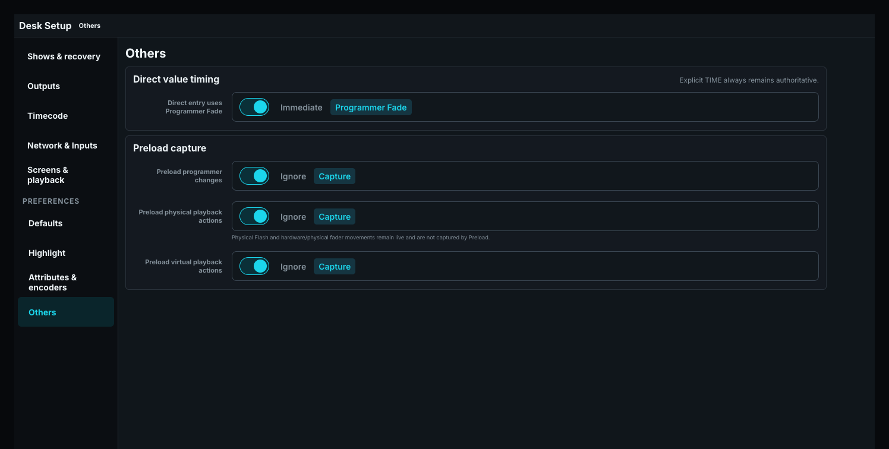
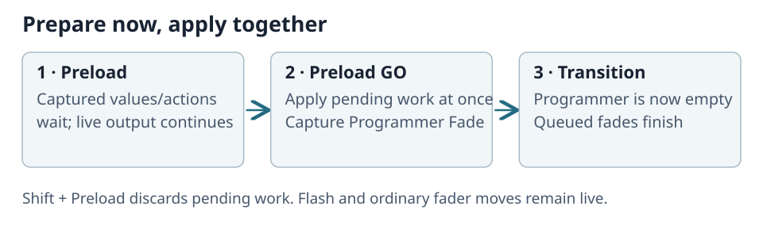

# Preload and Preload GO

Preload prepares a separate scene or queued playback actions without immediately disturbing normal live output.

## Capture eligibility

Programmer capture is an independent desk option. Playback eligibility belongs to the show and uses position ranges on pages 1–99. Ranges apply to all pages by default; optional page restrictions narrow the eligible addresses. For example, `1 THRU 8 + 101 THRU 108` captures eligible actions in those positions regardless of the software screen, pane or attached hardware used. Unmatched positions or restricted-out pages act live. Overlapping ranges never duplicate a captured action.

A fresh show makes positions 1–1000 eligible on all pages, and a fresh Programmer enables Programmer capture. Turn off Programmer capture to keep Programmer changes live while eligible Playback actions are still captured.

Playback capture retains only **Toggle**, **GO**, **GO minus**, **Off**, **On**, **Temp on**, and **Temp off**. Flash presses and releases, normal fader moves, and an On caused only by crossing zero remain live and are not captured. A configured **TEMP** button keeps its normal press-to-toggle gesture: one press queues Temp on and the next queues Temp off; it does not become a held button.

## Operator flow

1. Press Preload to enter the pending workflow.
2. Make programmer changes and/or execute configured playback actions.
3. Inspect Preload-aware Stage/Fixture views while separately verifying that live DMX has not changed unexpectedly.
4. Press **Preload GO** to apply the captured work atomically.
5. Use Shift Preload to clear the pending Preload without applying it.

The pending Programmer and one ordered Playback action queue are distinct. Each queued action retains its exact page.position address and original control source, including through page changes. A combined GO uses one commit point so the prepared change does not tear across frames. At that point the prepared values leave the programmer and enter a temporary transition queue, so the programmer is empty while the transition continues. **Preload GO** captures the current Programmer Fade once and applies that transition time to every pending programmer value, regardless of when or from which programming surface the value was prepared. Changing Programmer Fade after GO does not alter the running transition. Captured playback actions retain their own explicit Cue timing; when they have no explicit timing, the same GO-time Programmer Fade supplies their fallback. Cue Fade is not substituted. Preload changes are atomic: when Preload ends while you are still turning an encoder, dragging a fader or holding the Position joystick, the part of that gesture made before the switch stays in Preload, and the rest of the same motion continues on the normal Programmer as its own Undo step.

Hold Preload to open a modal listing every pending programmer change and captured playback action. Individual entries can be removed before GO. Shift Preload clears all pending work. Neither operation rewinds playback actions that have already been committed by Preload GO.

Use a dedicated Stage pane with **Follow Preload** for preview and another live-output pane for comparison.
