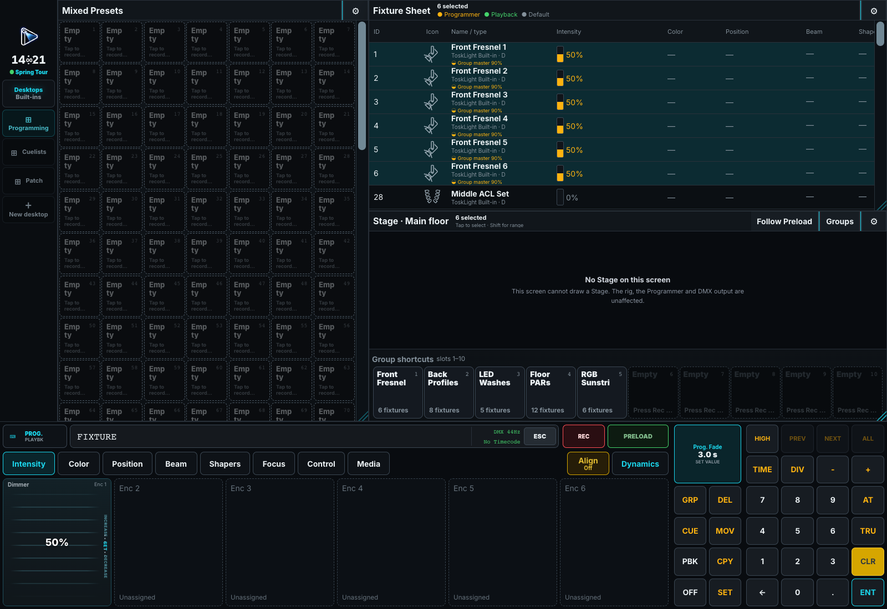

# Desk Interface and Windows

A **Desktop** is a saved arrangement of panes. A **built-in** opens one tool at full size without changing that arrangement.

## The shell

Use **DESKTOPS** and **BUILT-INS** in the left Dock to switch workspaces. The command line, Programmer, Playback controls, and Show menu remain available.

The Show menu opens shows, MVR exchange, Desk Setup, Help, and shutdown. **DMX** beside the command line opens **Running & Output**: use **Running** to inspect activity and **Desk State** for warnings. **All Off** asks for confirmation before releasing running Playbacks, Dynamics, and Programmer Preload.

A red warning beside DMX means Desk State needs attention. Rejected commands remain marked on the command line; connection failures appear in the top status message.

Each application window has close, fullscreen, and move controls. Closing the main window quits ToskLight; closing an optional screen leaves the desk running. Outside fullscreen, drag unused built-in title space to move the application. A pane header instead moves that pane inside its Desktop.

## Search bars

Type in a title-bar search to filter immediately. **X** clears it and the keyboard button opens text entry. If the magnifying glass includes a chevron, press it for search options.

## Desktops and panes

Choose **New desktop** in the Dock. Desktop settings rename it, change its icon and tile defaults, clone its layout, or delete it. At least one Desktop remains.

Add panes from an empty cell or **Open Window**, whose tabs are **Programming**, **Playback & Automation**, **Show & Visual**, and **Miscellaneous**. Drag a pane header to move it. Settings control exact position, size, and removal within the 24-column × 18-row workspace. Panes cannot overlap.

In **Settings > Pane Settings**, edit **Pane title** to give that instance a name. This does not rename its objects or its pane type in Open Window.

For tiled panes, choose **Tile layout**:

- **Automatic squares** keeps tiles square and fits columns to the pane width. This is the default for new panes.
- **Fixed grid** uses **Tile rows** and **Tile columns** to fill the pane, allowing rectangular tiles. Scroll for later entries.

Groups, Presets, Cuelists, Dynamics, Macros, Timecode, Media pools, and free-region Playbacks support these choices. Existing layouts keep their appearance until changed. Playback panes displaying controls or mirroring a Screen use that surface's authored arrangement; hide controls and use **Free region** for independent tile sizing.

**Type colors** uses the object-type or Preset-family default. **Individual colors** uses assigned presentation colors and grey for uncolored objects.

## Built-in windows

| Window | Main use |
| --- | --- |
| **Stage** | Spatial selection and 2D/3D views. |
| **Fixtures / Channels** | Select fixtures and inspect or set values. |
| **Groups / Presets** | Recall selections and reusable values. |
| **Cuelists / Cues / Playbacks** | Store, edit, and run looks. |
| **Dynamics** | Create and run animated values. |
| **DMX** | Inspect final output and diagnostics. |
| **Patch** | Configure fixtures, addresses, and placement. |
| **Desk Setup / Help** | Configure the installation and read the manual. |

**Running** is pane-only: add it through Open Window. Hold **Shift** in BUILT-INS for alternatives: Stage → Media, Fixtures → Groups, Cuelists → Timecode, Dynamics → Macros, Channels → DMX. Timecode and Macros are also available through Open Window.

See the [Pane Reference](index.md) for individual settings.

## Multiple screens

Configure optional screens under **Desk Setup > Screens & playback**. Each can show a Desktop or a fixed pane and use an **Own**, **Pinned**, or **Follow surface** Playback page. See [Screens and Desktop Layouts](../10-Show-Setup/02-screens-and-layouts.md).

## Where settings are stored

Desktop layouts, pane titles and presentation colors, screens, inputs, and installation preferences stay with the desk. Patch, stage placement, Groups, Presets, Cuelists, and Playback assignments travel in the show. Temporary Programmer values are shared across this desk's surfaces and become show programming only when recorded.
