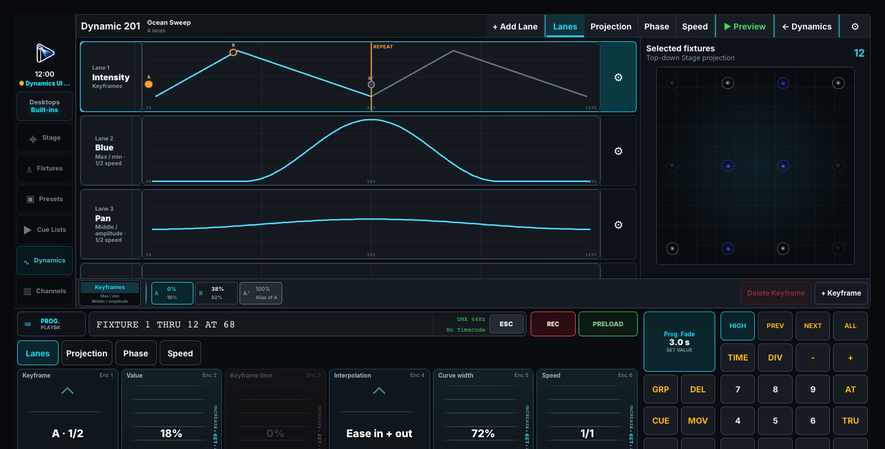

# Programming and Visualization Windows

## Preset pool

Tap a Preset to apply it to the current selection. Intensity, Color, Position, and Beam presets store their own family; Mixed presets can combine families. Record plus an empty position creates a Preset; recording onto a populated one offers the chosen merge/overwrite workflow.

Tiles show number, name, preview, and the number of fixtures currently on the Preset. With no fixtures selected, the first tap selects the Preset's stored targets; the second recalls it.

**Pane configuration:**

- **Preset family** keeps this pane on one family; Mixed is a separate family rather than an aggregate.
- **Type colors / Individual colors** selects the family default or individual presentation colors.
- **Show group shortcuts** adds a Group selection strip.

Use **SET** and a Preset for its local title, icon, and button color. These presentation choices stay with the desk; they do not change stored values.

For square tiles, **Desk Setup > Preferences > Defaults > Pools** and Desktop settings provide default and minimum widths. Increase the default for larger, fewer tiles. For an exact count filling a pane, choose **Fixed grid** in Pane Settings instead.

## Group pool

Groups store ordered selections. Tap one to select its members. Record onto an empty position stores the current selection; an existing Group offers the selected merge/overwrite workflow. Order affects spreading. A deliberately stored empty Group is different from an unused position.

Tiles show member counts and derived/frozen status. Hold one for membership, freeze/refresh, and Group-master controls. A Group Master limits member intensity without rewriting Cue or Programmer values. Missing fixture IDs are reported and skipped.

**Pane configuration:** choose Type colors or Individual colors and the common tile layout. Membership edits belong to the Group, rather than Pane Settings.

## Fixture sheet

Use the Fixture Sheet to select fixtures or heads and inspect current programming. It shows the ordinary static base; a Dynamic's icon identifies modulation without replacing that base with continuously changing values. Use **DMX** for the final changing output. Preload adds pending values for comparison.

Simple fixtures have one row; multi-head fixtures have a shared `.0` row and individual `.1`, `.2`, etc. Venue scenery stays in Patch and Stage, outside this programming table.

While stepping with PREV/NEXT, the original selection stays subdued and the current fixture is prominent. **ALL** restores the complete selection. Hidden subheads retain an indication on their master row.

### Fixture sheet columns

| Column | Shows |
| --- | --- |
| **ID / Icon / Name** | Fixture identity, optional profile detail, and status. |
| **Patch** | Universe/address or Unpatched; off by default. |
| **Intensity** | Base percentage and pending Preload value. |
| **Color** | Color swatch and name; a recalled Preset is named, otherwise the nearest known color appears in angle brackets. |
| **Position** | Aim glyph and angles in degrees. |
| **Beam / Shapers / Focus / Control** | The fixture's supported controls in those families. |
| **Media** | Content and supported Mask folder/file values. |

Unsupported families show **—**, rather than an invented color or position. Source styling distinguishes Programmer, Playback, and profile defaults. A snowflake marks full or partial **FREEZE**; **INSIDE** identifies frozen subheads hidden by the current view.

**Fixture Sheet** settings provide **View**, **Columns**, and **Groups**:

- **Compact mode:** Off shows text and graphics; **Icon only** and **Text only** use shorter rows. Status, selection, and Dynamic identity remain visible.
- **Included heads:** All, No sub heads, or No master heads.
- Choose Fixture ID or active-first ordering, active-only or Cuelist filtering, visible columns, and Group shortcuts.

Each pane keeps its own view. Narrow panes scroll rather than silently dropping configured columns.

## Media

Open Media from **Shift + Stage** in Built-ins or **Open Window**. Choose **Server**, then a layer. Selecting a layer selects that logical head for the Programmer.

Configure server connections in **Show Patch > Media Servers**. Connected servers supply names and thumbnails. Without CITP, the complete numeric folder/file ranges remain available. Offline or unavailable previews show their reason.

Touching a folder browses it without changing output. Touching a file applies that folder and file together as one Programmer edit. Media encoders apply immediately. **Media / Mask** chooses which content pair to browse.

Internal **ToskLight Audio Players** also appear in Server. They use the configured audio library, have no DMX or CITP endpoint, and show a music-note preview with live volume.

### Clip range

On **Playback**, touch **In point** or **Out point** and enter `mm:ss.ff`. In is measured from the start; Out is measured back from the end. A zero Out point means **End of clip**. Frames use the rate reported by ToskLight Media; when it is unavailable, the controls explain **Frame rate unknown** and accept frame counts.

**Clip length** is read-only. **✕ Clear playback range** resets both points to zero immediately. Unsupported or unreported clip lengths remain explicitly marked.

A pane remembers its server, layer, browser, and section. Disconnecting does not silently switch it to another server. Greyed controls indicate attributes the selected layer cannot use.

## Stage

Use Stage for spatial selection and inspection. **2D** shows the plan, **3D** shows models and aim, and **3D Viz** adds rendered light. Tap or marquee fixtures; Shift extends selection and Control/Command toggles it.

**Pane configuration:** choose the view, **Follow Preload**, and Group shortcuts. Each pane keeps its own camera, so Live and Preload views can coexist.

Drag to orbit, scroll to zoom, middle-drag to pan, and secondary-drag to slide. An unavailable Stage does not stop programming or DMX output.

### Stage is a selection and viewing surface

The full Stage window provides **Select fixtures** and **Navigate**. Navigate repurposes the encoder bank: **Position** controls camera X/Y/Z and Zoom, and **Direction** controls Pan/Tilt. These controls move the view, not the rig.

Edit physical placement in **Show Patch** or Architect. Use **Open Stage Renderer** for visual feedback while patching and add visual-only scenery from Venue profiles.

| Render quality | Appearance |
| --- | --- |
| **Draft** | Basic light cones. |
| **Standard** | Adds gobo patterns. |
| **High** | Adds feathered edges, falloff, and shadows. |
| **Ultra** | Adds uneven, drifting haze. |

**Environment brightness** reveals unlit scenery; **Background** changes the room color; **Exposure** is a fixed brightness multiplier, rather than automatic exposure. **Floor grid** adds metre-spaced reference lines.

With labels enabled, **UV** means native UV drive is active. The estimation mark means visible color prediction is incomplete. Stage does not simulate fluorescence or replace UV with purple. Verify the real fixture for critical focus and color.

Close the renderer when not needed, or lower quality while arranging the rig.

## Visualization

Visualization monitors DMX or fixture attributes without changing output. In **Pane Settings > Visualization**, add text, number, bar, or graph widgets and configure their source, range, scale, and style. Unavailable sources are marked.

## Channels

Channels provides direct programming faders. **Intensity only** gives each level-capable fixture a fader; **All channels** groups its attributes in profile order. Touching a card selects its fixture; moving a fader changes the Programmer.

Use **Pane Settings > Channels** for display mode. The full **Channel Settings** also controls faders per row and offers pages. A compact pane stays on the first bank. See [Channel Faders](07-channel-faders.md).

## Dynamics

Tap a Dynamic to toggle it on the selection; Shift-click opens its editor. Use **SET** and a Playback to assign it. The editor's **Lanes**, **Phase**, and **Speed** define animation, spreading, and timing.

**Take Selection** stores a target. A single Group remains live; other selections are frozen. **Clear Selection** removes the target. With no stored target or selected fixtures, the first tap selects compatible fixtures and the second starts the Dynamic.

Use a Live or Follow Preload Stage to inspect it. See [Programming Windows](06-programming-windows.md#dynamic-lanes) for lane units and examples.

