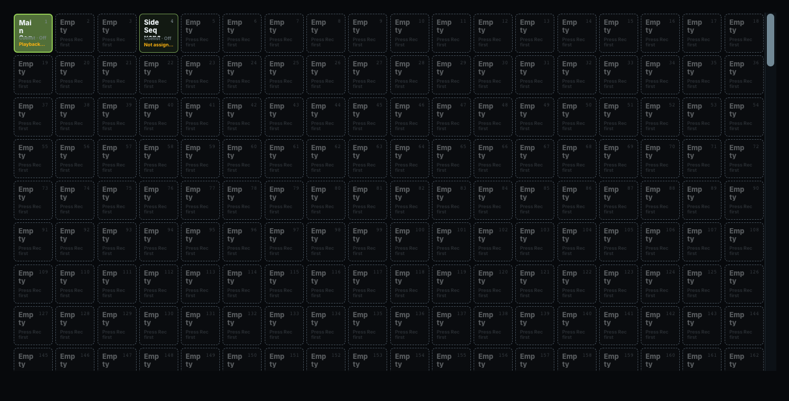
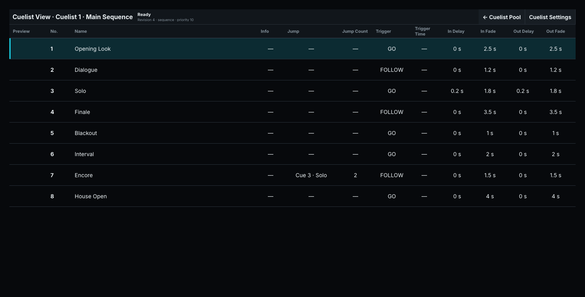
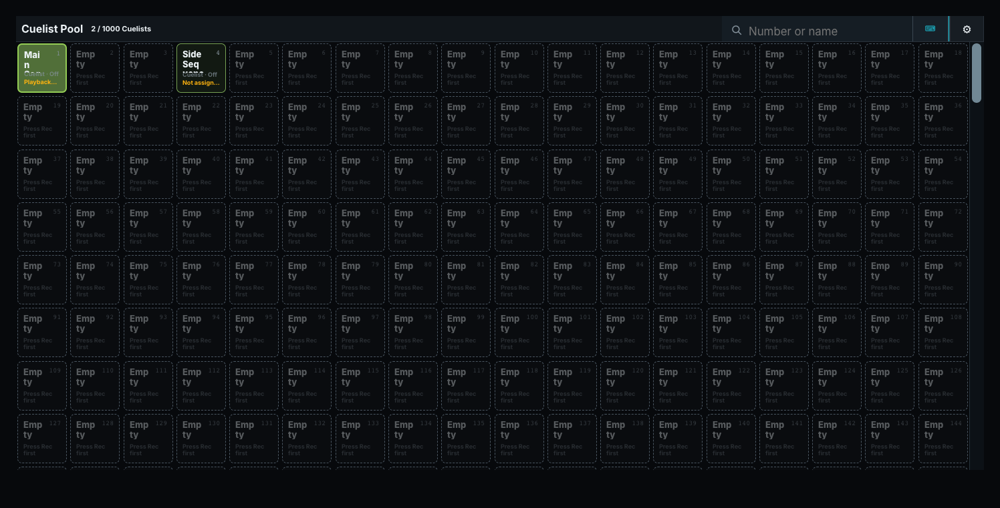
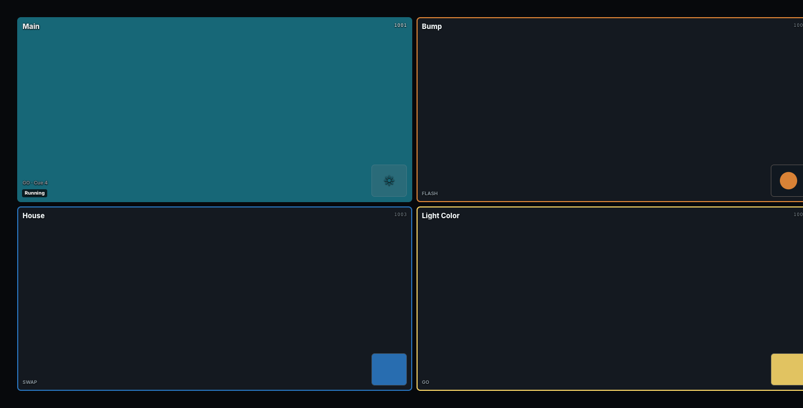
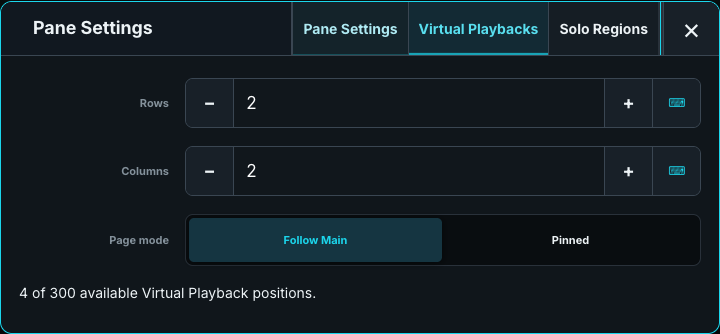

# Cue and Playback Windows

## Cuelist Pool

Tap a Cuelist to open its Cues. Hold or right-click its tile for settings. Tiles show number, name, Cue count, and a ▶ when running; tap a preview image to enlarge it.

Record plus a pool position creates or updates a Cuelist. With Set armed, outlined populated tiles are assignment targets. Otherwise, an ordinary tap opens the list.

The full window searches by number or name. Cuelist settings include Sequence/Chaser mode, priority, HTP/LTP intensity, wrap/restart behavior, and timing. **Chaser X-fade** is a percentage of each step: 0% snaps, 50% fades for half the step, and 100% fades throughout it.

**Pane configuration:** Type colors or Individual colors, plus common layout controls. Cuelist settings change the show object rather than this pane.

## Cues - Cuelist

The table shows one Cuelist's Cues, previews, triggers, and In/Out delays and fades. Current and next Cues are marked. Selecting a row does not run it.

Touch a value to edit it. **Name** opens text entry; numeric timing opens the number pad; trigger and jump fields offer their relevant choices. **Out Fade > Use Release** follows the desk's Release timing master, and **Out Delay > Use In Fade** follows the Cue's In Fade. Enter a number to make a linked field independent.

Timing cells fill as their real trigger, delay, or fade runs. Incoming and outgoing phases progress independently. Pause freezes the indicators; the completed fill remains until that Cue runs again.

Copy, Move, and Delete outline eligible Cue rows. Touch a row to address that complete Cuelist/Cue; navigation and scrolling remain available. Set outlines editable values rather than executing the Cue.

### Previews

Stage previews are stored pictures of the Cue, not live renderers. They travel with the show and refresh when the relevant programming or rig changes.

A media-only Cue can use a ToskLight Media preview. One layer shows that layer over a transparency checkerboard; a master or multi-layer Cue shows the composed Program. Lighting/media mixtures keep a Stage preview. Media previews require the corresponding server and library.

| Preview message | Action |
| --- | --- |
| **Loading media preview** | Wait for the server to load it. |
| **Empty media** | Check selected media, layer level, and master. |
| **Media output missing** | Update or repatch the output. |
| **Media Server offline · Retry** | Check connectivity and tap to retry. |

### Settings and following

The full window returns to the Pool and opens **Cuelist Settings**. Choose mode, priorities, wrap/restart, and timing, then **Save**. Closing unsaved settings offers Save, Discard, or Stay.

In Pane Settings, **Displayed Cuelist** can be **Fixed** or **Follow selection**. Fixed keeps one chosen list. Follow selection shows the explicitly selected Playback's Cuelist; a non-Cuelist Playback leaves it empty. The row follows its actual current Cue, including Chaser steps.

**Compact Cue rows** reduces row height and hides preview pictures. Common position, size, and removal controls also apply.

## Cuelists (tabs)

**Cuelists** integrates the Pool, Cue table, and settings. It currently replaces the Pool with the chosen list rather than showing several tabs. In a compact pane the full-window Back control is hidden; reopen or replace the pane to return to the Pool.

Use **Cues** for a permanent fixed/following Cue overview.

## Running

Running lists Cuelists, standalone Dynamics, Timecodes, and Macros. Several controls operating the same object produce one row. A Dynamic inside a Cuelist remains part of that Cuelist rather than a second stoppable row.

Each **Off** stops exactly its named object. Cuelist rows show the current Cue; other objects show **Cue —**. Filter with **All**, **Cuelists**, **Dynamics**, **Timecodes**, or **Macros**.

Running is pane-only: add it through **Open Window**. **Running kind** saves that pane's filter.

## Macros

Tap a Macro to run it; right-click or use **SET** to edit it. The editor provides **Run Macro**, **Run line**, and **Undo last run** where available. See [Command Line Reference](../20-Programmer-and-Cues/01-command-line.md) for syntax.

## Timecode

Use the Timecode Pool and editor to place Cuelist, Speed, and Audio lanes against one timeline. Markers label times but do not execute output. Linked main audio stays pinned below the ruler while other lanes scroll. All lanes share the same horizontal scrolling and zoom. The red playhead time stays pinned at the top while lanes scroll. A pencil beside a Speed Group title identifies its edit view; tap the lane title to expand it. Selecting a keyframe leaves lane geometry unchanged, and a tap makes no timing or value edit. Marker names and dotted drag grips sit in the ruler above the lanes and stay visible while scrolling vertically. Drag a flag to move its marker. Marker lines are half transparent and do not intercept lane controls; the red playhead stays above them.

Each Cuelist always has its own compact lane. Cue blocks begin at their actual trigger times and show the Cue name and exact time. Tap a Cue to expand its fade controls; **Close** restores the compact Cue blocks.

**Speed Groups** appear below the main audio. These supplementary lanes and **Audio Players** can fold into a single 44-pixel preview row. **Expand** reveals their individual lanes; tap a Speed Group name to enlarge it for editing.

Scrubbing the ruler or dragging the playhead inspects a position without seeking live output. The **Playhead** encoder shows that editor position; press the title's transport position button to seek explicitly.

Edits autosave while transport runs. Check **Saving…**, **Saved**, or **Not saved**; use **Retry autosave** after a failure. Stop remains available. Duration and offset use `HH:MM:SS.FF` at 44 fps; Escape restores an unfinished field.

Select a clip to edit its Cue range, start/end behavior, or audio folder/file, repeat, and volume. Speed keyframes expose BPM and phase; audio-volume keyframes expose fades. Copy/Delete controls operate on the selected clip, keyframe, or marker. Editor Undo/Redo recovers changes.

### Cue timing on the timeline

All Cues of a Cuelist share one lane as overlapping envelopes, with their names at the bottom. Tap an envelope or its name to expand that lane downward. The expanded envelope area is twice the height of the Cue-name strip, and selecting a Cue reveals the whole lane vertically. A rounded rectangular grip with a vertical bar on each side of the boundary marks each editable interior Cue; drag it to move that Cue's Trigger. The beginning and end use the same grip cut through its centre at the exact clip edge: the beginning shows its right bar and half-rectangle, and the ending its left bar and half-rectangle. Drag the beginning half-grip to move the whole clip, preserving its duration and relative Cue positions; drag the ending half-grip to change the clip end. Automatic Cuelist triggers remain derived. Only the selected Cue's four **In delay**, **In fade**, **Out delay**, and **Out fade** points appear, anchored to the envelope corners. When two points coincide, labelled touch regions keep them independently editable while the dots remain on their corners. Speed Groups retain their section highlight until collapsed, with a stronger highlight on the working lane. While a Cue is open, other Cuelists and Speed Groups dim. Tap another Cue to edit it; **Close cue editor** on the left restores the compact lane. The selection sidebar is off by default. Enable **Show selection sidebar** in **Timecode Settings** for exact settings in expandable **Cue In**, **Cue Out**, and **Cuelist** sections. Its Close button hides only the sidebar; the Cue lane remains expanded and selected. Cue In includes the exact Trigger and its source, Clip start frame and In start/end; Cue Out includes Out start/end and Clip end frame. Cuelist contains the Start/End Cue and start/end behavior. The **Prev Keyframe** and **Next Keyframe** icon buttons appear in the window title while working on Speed or audio-volume keyframes. **Delete clip** appears for a selected clip, with no bottom action row. Cue navigation remains on the encoders. In expanded view, drag the **Extend last Cue** end grabber in the bottom Cue-name row, aligned with the other Cue grips to change clip end without moving earlier Cue triggers. Opening or closing these settings keeps the timeline's zoom and left-hand position unchanged; use the overview or encoder zoom to change the visible range. The overview uses the same time axis as the lanes, including blank space retained when the window grows or the sidebar closes. Its outlined window shows the visible time range. Pull both overview edges to the track ends to fit the current viewport.

Drag the timing points to change the Cuelist's actual delays and fades, snapped to frames. Out delay begins at the handover to the next Cue. When timing points meet, short connectors separate their handles so each remains draggable. Dragging a linked Out timing explicitly replaces its link with independent timing. An In fade of zero inherits the desk's **Cue Fade**; an explicit Out fade of zero is immediate.

The labelled **Trigger** control in Cue In shows the exact time a Cue starts. In delay runs from Trigger to In start; the In fade runs from In start to In end. The first Cue starts with the clip. Moving its Trigger moves the whole clip without changing its length or the later Cues' relative positions. A manual-GO Cue's Trigger can be placed inside the clip without changing its manual trigger for ordinary playback. Until placed, it follows its predecessor's completion. Moving the clip carries the placement with it. Follow, Wait, Link, and Timecode triggers remain derived from the Cuelist; selecting a Cue does not convert them to manual placements. Trigger movement stops at legal neighbouring Cue boundaries.

The final Cue has no later handover inside the clip. Its shared Cue Out timing does not run after clip end. Use the separate **Clip Out** gain fade to fade the clip before its end, including a single-Cue clip. **Hold** retains the final state and **Release** removes the clip's ownership at its end.

Each Cuelist clip shows **State Start** or **Cue Start** at its left edge and **Hold** or **Release** at its right edge. These are its configured start/end behaviors; an unresolved reference still shows an actionable **Unable** error. **Add…** stays to the left of keyframe navigation as the selection changes and creates lanes and markers; **Add clip** adds a clip to the selected lane. New Cuelist lanes start with a clip; Speed lanes start with a keyframe. Select a marker and use **Place Marker** for the playhead position or **Move To** for an exact time.

### Running

Playing drives the same Cuelist runtime as other controls. Pause holds timing and output; seek and loop restore the state appropriate to their destination. **Hold** keeps a clip's final Cue until superseded; **Release** relinquishes it at the end. Missing Cuelists or Cues remain marked for repair.

Configure input source, frame rate, loss behavior, audio device, and latency in Desk Setup. See [Triggers, Chasers, and Speed Groups](../20-Programmer-and-Cues/13-triggers-chasers-and-speed.md).

## Virtual Playbacks

A Playbacks pane operates the same show assignments as screens and hardware. Pages 1–99 have positions 1–1000. An explicit `page.position` always addresses that assignment, regardless of the displayed page.

Configure rows, counts, buttons/faders/encoders, and an **Own**, **Pinned**, or **Follow** page source. **Take from Screen** copies a saved screen arrangement into a draft: review it and press **Apply**. This copies layout, not assignments, and does not follow later edits.

Right-click a control or use **SET** for Playback Configuration. Actions, colors, icons, and images belong to that Playback. Pane Settings controls layout and **Solo Regions**, including their colors and addresses across pages.

For full-window tile sizing and the current Cue insert, see [Virtual Playbacks](../20-Programmer-and-Cues/14-virtual-playbacks.md). Preload eligibility is configured separately; Flash and fader movement remain Live. See [Preload](../20-Programmer-and-Cues/12-preload.md).

