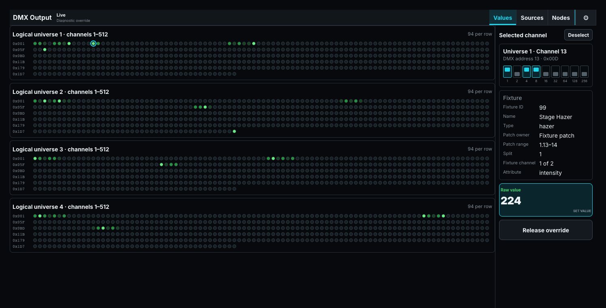
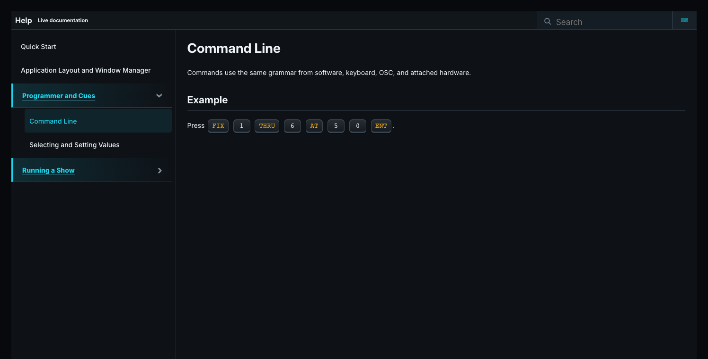

# Output and Help Windows

## DMX output

**Values** shows the final raw output, up to 512 slots per universe. Select a slot to inspect its address, patched fixture/channel, and raw value. A diagnostic override bypasses normal programming: choose **Release override** when finished.

With no slot selected, inspect output health: measured frame rate and send errors over the last 60 seconds, plus **Change lead time** from a Cue or Dynamic starting to its first sent frame. **Reset** starts new lead-time readings for a test run.

The compact pane shows Values for the first two universes. The full built-in also provides **Sources** for raw overrides, **Nodes** for network endpoints, and **DMX Settings** for dot size.

| Nodes status | Meaning / action |
| --- | --- |
| **Active / Listening** | Data is flowing, or the listener is ready. |
| **Idle / Disabled** | No recent traffic, or the route is switched off. |
| **Conflict** | Another source sends the same universe. Change one source or route. |
| **Error / Unavailable** | Read the reason and check the route, interface, or transport. |

Rows identify protocol, delivery mode, direction, address, and universe. Configured routes show logical > destination universe. Select a row for details. ToskLight's own applications are named so they can be distinguished from another console.

Configure routes under **Desk Setup > Outputs**, rather than in this monitor. See [DMX Output and Universe Routes](../10-Show-Setup/04-dmx-output.md).

## Help

Help presents the same topics as this manual. Select a topic in the left column to read it on the right. Follow links for related workflows and use the pane's size controls for a larger reading area.

**Pane configuration:** common position, size, title, and removal settings.

