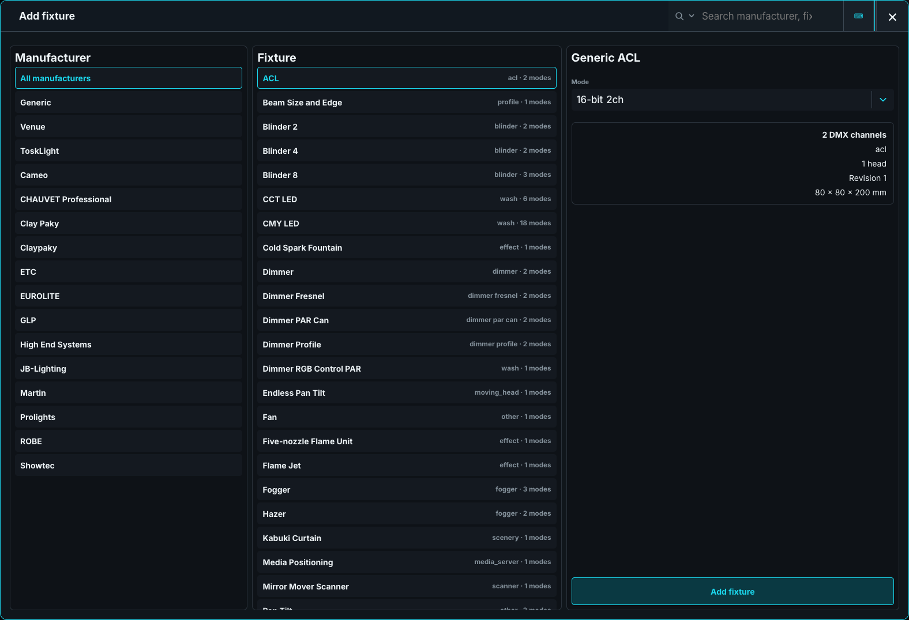

# Add and patch fixtures

Build the rig in Architect or directly in Control. Both applications use the shared fixture library and patch sheet. Architect is optional.

In Control, open **Show > Show Patch**. In Architect, choose **Patch** in the sidebar. Choose the exact profile revision and mode before adding fixtures; the show embeds that revision.

## Add fixtures

1. Choose **+ Add fixture** and search by manufacturer, fixture, or mode. The list filters as you type.
2. Select the mode and check its footprint and physical details.
3. Set **Count** and **Start fixture ID**. Used IDs are skipped while the requested count is preserved.
4. Choose **Address** and enter a starting `universe.address`, or **Empty** to leave the fixtures unpatched.
5. Check every proposed footprint, then choose **Add fixtures**.

An unpatched fixture remains selectable and programmable. It keeps its profile, position, Groups, Presets, and Cues, and produces no DMX until patched.

**Cancel**, **Add fixtures**, and Close are in the placement title bar. Closing after changing values asks **Yes, close** or **Stay in Add Fixture**; staying preserves the entries.

## Set addresses

The placement grid shows all 512 slots of a universe. Existing fixtures are grey, proposed fixtures are blue, and collisions turn red. Each range shows its fixture ID and name.

Drag a proposed range, or select it and touch a free address, to change that fixture's address. Each fixture in a batch can have its own address. Every footprint must fit in its universe and avoid existing or proposed fixtures.

For keypad entry after choosing a fixture type, enter `<amount> [AT] <universe>.<address>` and press `[ENT]`. The batch advances by the selected mode's footprint. Chain entries before `[ENT]` to place batches at several addresses.

Independent splits have separate addresses and footprints. See [Heads, splits, and multi-patch](04-heads-splits-and-multipatch.md).

## Repatch or unpatch

Select an address cell and press `[SET]`, or press `[SET]` before touching the cell. Choose the new `universe.address`. **Clear address · Unpatch** removes only the selected split's address.

The desk checks the complete patch before applying it. An invalid address or collision leaves the current patch unchanged. Closing without confirmation discards the pending address.

## Scenic objects

The manufacturer list starts with **All manufacturers**, **Generic**, and **Venue**, followed by manufacturers alphabetically. Venue objects use reserved IDs beginning `0.1`. Their placement asks for name, count, and mode, without a DMX address.

Scenery remains in Show Patch and Stage. Visual-only profiles and IDs beginning `0.` are excluded from the Fixture Sheet. Continue with [Build the venue](../04-build-the-venue.md) after placing the lights.

## Check the patch

In Control, inspect **DMX > Universe** for footprint and channel ownership. Set a safe test value and check real output. Save a named revision before a large repatch.

