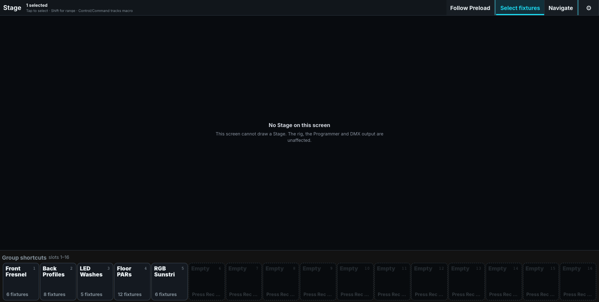
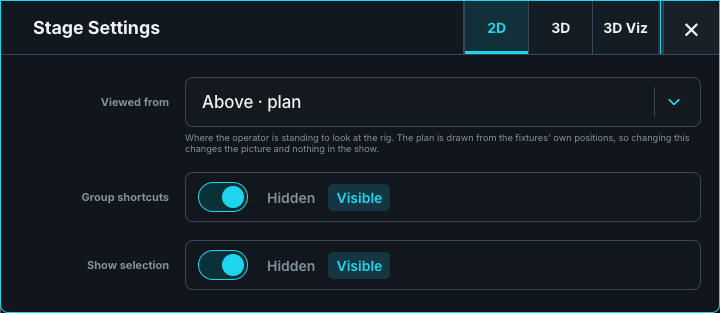

# Check the rig on Stage

Stage is a selection and viewing surface for the show's saved rig. Edit installed positions in **Show > Show Patch**, or use Architect's CAD tools. Every Stage view uses those same 3D positions.

Control Stage provides a 2D plan and a lightweight 3D wireframe view. For full lighting, haze, and shadows, open the [separate Visualizer](../../10-ToskLight-Architect/11-visualizer.md).

In 2D, choose a view from above, front, back, or either wing in Stage settings. Moving a fixture in Patch updates every view. The 2D view has no separate fixture arrangement to maintain.

Choose **Select fixtures** to work on the Programmer selection, or **Navigate** to orbit and inspect. Navigation leaves fixture positions unchanged. **Open Stage Renderer** in Show Patch opens the dedicated Visualizer beside the patch.

## Inspect dark fixtures

In 3D, **Beam direction guidelines** draws a dotted aim line for a directional emitter while it is off. The setting starts off and is shared by Control's Stage window and panes; fixed additional screens retain their own choice. It is unavailable in 2D.

Broad sources such as strobes and Sunstrips remain visible without an aim line. Check their orientation in Patch and the fixture's model.

## Add or change scenery

Use the [shared patch guide](../../10-ToskLight-Architect/02-Fixtures-and-Patch/index.md) to add Venue objects. [Build the venue](../../10-ToskLight-Architect/04-build-the-venue.md) covers generated objects, dimensions, imported venue models, and placement. Venue objects remain in Patch and Stage and travel with the show.

Patch layers control the same scenery and lights in Stage and the Visualizer. Standalone MVR geometry is reported as an import warning; recreate required scenery as Venue objects.

## Compare live and pending looks

**Follow Preload** selects whether a Stage view displays live output or the pending Preload scene. Two panes can make different choices, so both looks can remain visible while you prepare a transition.

Stage is a programming aid. Confirm color, focus, beam, and intensity on real fixtures, and inspect DMX output when diagnosing a mismatch.

