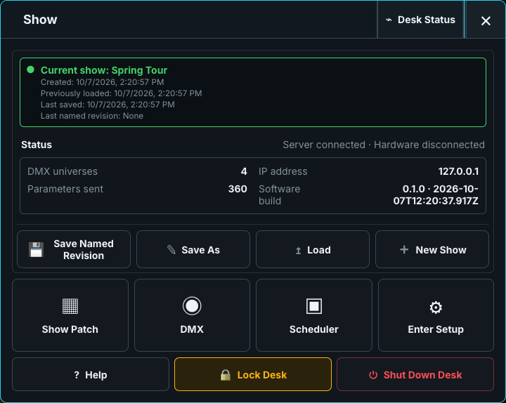
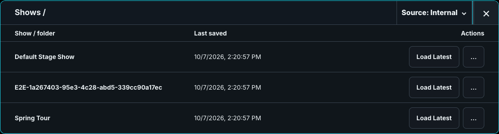

# Named revisions and show copies

Use a named revision as an immutable restore point. **Load Latest Autosave** resumes the newest work; **Load Revision as Copy** opens an independent show without rewinding the original.

The copy name identifies the source show, revision number, and date. Its source remains visible in the Show menu and left dock. Later changes autosave to the copy, which stays in the library after a restart and can have its own revisions.

Because autosave already protects the active copy, **Save** asks where the copy should remain. Choose **Keep as Separate Show** to leave it independent, or **Overwrite Original Show** to replace the original show's mutable Latest Autosave. If the original was deleted, the overwrite-original choice is unavailable and the copy remains fully usable.

For an established, named show, **Save As** can create another named show or select the original or another existing show as a destination. Choosing an existing destination opens a separate destructive confirmation; cancel is the safe default. A confirmed overwrite first creates an internal recovery backup, replaces only the destination's Latest Autosave, and preserves the destination identity and all of its named revisions. The revision copy and immutable source revision are retained until explicitly deleted.

