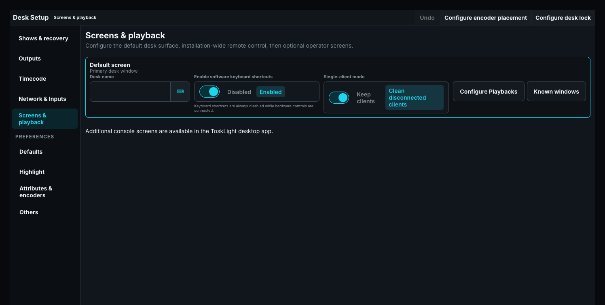

# Place the encoders

Choose **Configure encoder placement** in the Screens & playback title bar. Its **Encoder placement** modal decides which screen carries the encoder section, independently of the
Playback controls. Choose **Encoders on** to select the main screen or any optional screen, and
**Visible encoders** to show four, five, or six controls, including with attached hardware.

The main screen keeps its whole programmer whatever the placement is. While the encoders live on
another screen, the main screen still carries its command line, its keypad and its Delete and Move
tools, and its Programmer/Playback toggle stays available; only the encoder pane itself moves, and
it names the screen the encoders went to. It does not announce the placement anywhere else; the
setting you made stays out of the main screen list. If the chosen screen is closed, the same modal shows
the placement warning and offers **Use encoders on this screen** to take the encoders back in one
explicit action.

An optional screen that carries the encoders and also shows **Playbacks** or **Page Controls**
offers a **Playback**/**Encoders** switch and starts on **Encoders**. The switch has no row of its
own: on the encoder view it sits at the end of the encoder group tabs, directly right of
**Dynamics**; on the Playback view it sits in the page controls, directly above **PAGE UP**. Neither
section loses height to it. It is a single button carrying both labels, the current section in blue
and the other in white; pressing it changes section. The button keeps the same size and place in
either view, so the row around it never moves. A screen that carries only one of the two shows that section without a
switch.

**Compact encoder assignments** adds readouts beside hardware Playbacks. Press **Int**, **Col**, **Pos**, or another group to select it; press again for the next page. These readouts do not edit values. The option starts off.

Playback rows divide available height according to their controls. Every configured row fits without scrolling. Enlarge the region or configure fewer controls if touch targets become too small. Edit Solo Regions in a Playbacks pane showing that screen, or hold the lower **PROG/PLAYBK** control.

