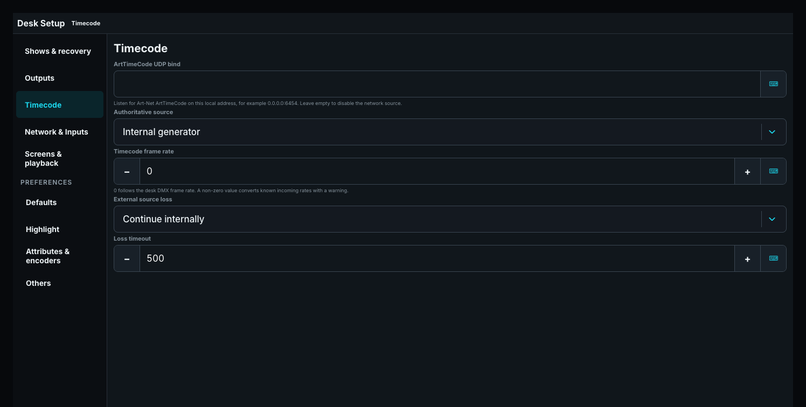

# Timecode

The Timecode Pool stores portable timelines. The editor has transport, seek, a complete overview,
markers, and Cuelist, Speed, and Audio lanes; select an item to edit its timing and properties.
Markers label positions but do not execute output. The timeline and its optional audio run from one
authoritative clock, so reopening the editor restores the live position.

Scrub the ruler or drag the playhead to inspect a position without changing live output.
The **Playhead** encoder shows the editor position. The title position button shows the live
transport position; press it to explicitly seek to the position selected with the playhead.

Edits save automatically without resetting a playing or paused transport. The title reports
**Saving…**, **Saved**, or **Not saved**; a failed write retains your draft and offers **Retry
autosave**. **Stop** remains available while edits save. Duration and transport offset accept
`HH:MM:SS.FF` at 44 fps; incomplete typing stays local, and invalid entries explain the accepted
range when you leave the field. Press Escape to restore the current saved field value.

Select a clip to edit its Cue range and start/end behavior, or its Audio Player folder, file,
repeat, and volume points. Selected Speed keyframes expose phase; audio-volume keyframes expose
fade duration. **Copy clip**, **Copy keyframe**, and **Copy marker** duplicate the selected item;
use its Delete action to remove it and editor Undo/Redo to recover changes. A copied clip needs
an empty interval on its lane. Waveform loading and failures are visible, and **Retry waveform**
reloads the selected audio without changing transport.

A Cuelist clip contains the individual Cues in its selected Cue range. Each Cue shows its start
position, its **Out fade** across the top of the lane, and its **In fade** across the bottom. The
start and end handles of each range snap to Timecode frames. Moving a start handle changes the
corresponding delay boundary; moving an end handle changes when that fade completes. The desk saves
the resulting delay and fade duration on the authoritative Cue in the Cuelist. The clip retains only
its Timecode placement, Cue range, and State Start or Cue Start plus Hold or Release behavior; it
does not keep a second private copy of Cue timing. A linked timing range names its source; dragging
one of its handles is the operator's explicit choice to replace that link with the displayed
independent timing.

A new Cuelist lane opens with one clip already placed. On an empty lane that clip takes the rest
of the timeline from the playhead; where the lane already has clips it copies the length, Cue range,
and behavior of the last clip left of the playhead; and a Cuelist whose Cues all schedule themselves
supplies its own length. A new Speed lane likewise opens with one keyframe at the start of the
timeline. Select a keyframe and enter its **BPM** directly or through the number pad.

A Cue with a manual **GO** trigger has no automatic start time, so the Timecode clip stores its transition point. Such a Cue shows a movable transition handle inside the clip; drag it, or use the
arrow keys, to place the frame where the clip advances to that Cue. Until a point is placed the Cue
follows its predecessor's completion, and the handle is drawn dashed to show the position is still
the default. The transition is stored on the clip as an offset from the clip start, so moving the
clip carries its transitions with it and the Cuelist keeps its manual trigger for live use.

With a marker selected, **Place Marker** moves it to the current playhead and **Move To** opens a
modal for typing an exact timecode.

Playing Timecode drives that shared Cuelist runtime and shows which clip and Cue are executing.
Pause freezes Cue timing and output. Seeking, moving backwards, resuming, and looping reconstruct the
same current Cue, tracked state, timing progress, and output that uninterrupted playback produces at
the same frame. **Hold** retains the clip's final Cue until it is superseded; **Release** removes the
clip's Cuelist ownership at its end frame. A missing Cuelist or Cue remains visible with a recovery reason. The editor restricts Cue-order and fade-boundary edits to valid choices. The editor never shows
a clip as executing merely because the Timecode transport is Playing.

Configure the source, frame rate, loss behavior, audio device, and latency trim in Desk Setup. See
[Triggers, Chasers, and Speed Groups](13-triggers-chasers-and-speed.md)
for timing and trigger behavior.

## Edit Cue timing

The upper band shows Out delay and fade; the lower band shows In delay and fade. Hollow blocks are delays, and solid blocks are fades. The boundary between them sets delay; the far fade edge sets duration. Editing them changes the same Cue values shown in Cuelist View.

The clip itself is dragged by the handle across its top third, which carries the Cuelist name and its playback number. Dragging either end of that handle scales the clip: the Cue delays and fades inside it, and any placed transition points, all stretch or compress in proportion, so a section keeps its shape at a new length. With a clip selected, **Prev Cue** and **Next Cue** step through the Cues it spans, and the encoders address the selected Cue as In delay, In fade, Out delay, Out fade, with the Cue selection beside them.

## Source and synchronization

Choose exactly one Timecode source under **Desk Setup > General**: the desk's internal generator or one exact external source identity. There is no automatic priority list. Select whether loss of the chosen external source continues on the internal clock, pauses running Timecodes, or stops them; the selected source takes authority again as soon as it returns. The desk Timecode rate can follow the DMX rate or use an explicit whole-frame rate. A known incoming rate is converted and reported; an unusable sample is rejected rather than guessed.

The same Setup section selects the server audio-output device and its signed latency trim. Rehearse loss and return with the exact adapter and device used for the show; visible frames alone do not prove that the intended source or audible output is synchronized.

## Start from the command line

`[^CUE] <timecode-number> [ENT]` runs the addressed Timecode. Add `[+]` before Enter to arm autoplay or `[-]` to disarm it. `[SET][^CUE] <timecode-number> [ENT]` opens the editor.

Check [Cue timing](17-cue-timing.md) before adjusting shared Cue fades from a timeline.
