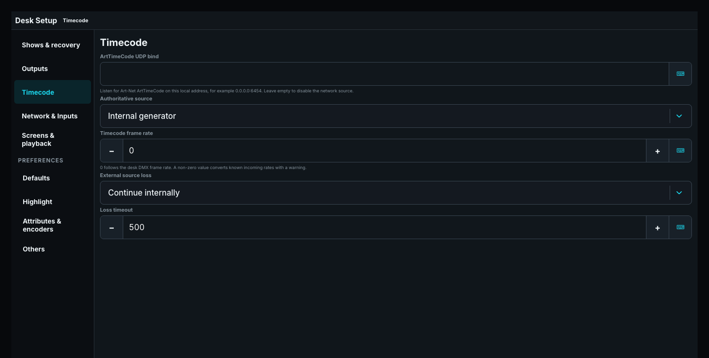

# Timecode

A Timecode places Cuelists, Speed Groups, and audio on one timeline. Open it from the Timecode Pool. The editor and optional audio share one transport; reopening the editor shows the live position.

## Build the timeline

Use **Add…** for lanes and markers. A new Cuelist lane starts with a clip, and a new Speed lane starts with a keyframe. **Add clip** adds another clip to the selected lane. Each Cuelist has its own compact lane with Cue blocks at their actual trigger times, showing names and exact times.

Select a clip to choose its Start/End Cue and start/end behavior, or its Audio Player folder, file, repeat, and volume points. Speed keyframes expose BPM and phase; audio-volume keyframes expose fade duration. Markers label positions without executing output.

**Copy clip**, **Copy keyframe**, and **Copy marker** duplicate the selected item. A copied clip needs an empty interval in its lane. Use its Delete action to remove it, or editor Undo/Redo to recover an edit. **Delete clip** appears for a selected clip in the window title. **Prev Keyframe** and **Next Keyframe** appear while editing Speed or audio-volume keyframes; Cue navigation stays on the encoders.

Select a marker and choose **Place Marker** to use the playhead position, or **Move To** for an exact time. [Timeline navigation](36-timecode-navigation.md) covers scrolling, zoom, markers, and the overview. [Cue timing on the timeline](35-timecode-cue-editing.md) covers Trigger, fade points, and clip boundaries.

## Inspect and run

Scrub the ruler or drag the playhead to inspect another time without seeking live output. The **Playhead** encoder shows that editor position. Press the transport-position button in the title to seek explicitly to it.

Playing drives the same Cuelist runtime as other controls. Pause holds Cue timing and output. Seeking, resuming, moving backwards, and looping reconstruct the state and timing progress appropriate to that frame. The editor marks the clip and Cue actually executing; Playing alone does not mark an inactive clip as executing.

**Hold** retains the final Cue until superseded. **Release** removes the clip's Cuelist ownership at its end. A missing Cuelist or Cue stays visible with an actionable **Unable** error, so it can be repaired.

## Save and recover edits

Edits autosave without resetting playing or paused transport. The title shows **Saving…**, **Saved**, or **Not saved**. A failed write keeps the draft and offers **Retry autosave**. **Stop** stays available while edits save.

Duration and transport offset use `HH:MM:SS.FF` at 44 fps. Incomplete text stays local; invalid entries explain the accepted range when you leave the field. Escape restores the saved value. Waveform loading and errors are shown; **Retry waveform** reloads audio without changing transport.

## Source and synchronization

Choose exactly one Timecode source under **Desk Setup > General**: the desk's internal generator or one exact external source identity. There is no automatic priority list. Select whether loss of the chosen external source continues on the internal clock, pauses running Timecodes, or stops them; the selected source takes authority again as soon as it returns. The desk Timecode rate can follow the DMX rate or use an explicit whole-frame rate. A known incoming rate is converted and reported; an unusable sample is rejected rather than guessed.

The same Setup section selects the server audio-output device and its signed latency trim. Rehearse loss and return with the exact adapter and device used for the show; visible frames alone do not prove that the intended source or audible output is synchronized.

## Start from the command line

`[^CUE] <timecode-number> [ENT]` runs the addressed Timecode. Add `[+]` before Enter to arm autoplay or `[-]` to disarm it. `[SET][^CUE] <timecode-number> [ENT]` opens the editor.

Check [Cue timing](17-cue-timing.md) before adjusting shared Cue fades from a timeline.
