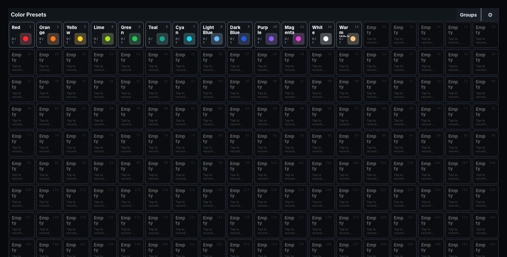

# Presets

Preset families are Mixed, Intensity, Color, Position, and Beam. Intensity stores only intensity attributes, including Shutter and Strobe. Color stores RGB, CMY, color-wheel, and other Color attributes. Position stores only Position attributes. Beam stores Beam and Focus attributes such as Zoom, Iris, Gobo, Prism and Frost. Mixed stores any attributes the operator chooses; it does not mean a combined list of every preset family. Recalling a Preset applies compatible values to the current selection while retaining the relationship needed for later updates where supported.

Each family is a separate pool with its own local preset numbers. The command-line address combines type and number: `0.1` is Mixed 1, `1.1` is Intensity 1, `2.1` is Color 1, `3.1` is Position 1, and `4.1` is Beam 1. The dotted address is not a global preset ID, so all five presets numbered 1 can coexist.

For quick recording, press `[REC]` and touch a Preset. With the normal **Smart** desk default, an existing Preset merges the Programmer and shows **REC MRG**; an empty slot creates a Preset and shows **REC**.

Merging keeps other stored values and replaces matching values with the Programmer's values. A saved alternative Record default or a one-off option still applies. To replace the entire existing Preset, choose the one-off **Smart** option, touch the tile, then choose **Overwrite**. On the command line, `RECORD SMART 2.1` explicitly overwrites Color Preset 1.

When you recall a Preset and record its values into a Cue, those addresses retain their source
Preset. Merging or updating that Preset changes the linked Cue values, including a Cue that is
already running. Clear the Programmer to see playback alone. Editing a recalled value directly
before recording stores that address independently; the other recalled addresses keep their links.
Older Cues containing only recorded values remain independent.

Moving a Preset preserves its links. Copying it creates a separate source. Deleting the source,
or removing an attribute it supplied, makes a Cue use its recorded fallback; Cuelist View explains
the missing source and how to restore or re-record it. A new Preset at the old number does not
take over that link. Shows containing these links require a runtime that supports live Preset
references; an older runtime refuses the show rather than silently changing its behavior.

The lower-left corner of every stored Group and Preset tile shows how many fixtures it holds. A Group
tile reads its member count, for example `8 fx`. A Preset tile reads `active/defined`, for example
`3/8 fx`. The
second number counts every fixture the Preset defines, including the members of any Group it
stores and fixtures that are currently unpatched. The first number counts the fixtures whose
current effective values, after the Programmer and every Playback have been merged, match every
value the Preset stores for them; a Preset that is only stored, or whose values another source
has overridden, is not active. The count follows the live output state while the pane is open. A
Preset that defines no fixtures shows `0/0 fx`. In a [Color Intent](05-color-intent.md) show, a Color preset that holds one shared colour is **universal**: it applies to every selected fixture and its tile reads **Any** with the number of fixtures currently showing it, for example `Any · 2 fx`.

## Preset previews

[Preset previews](../30-Windows/13-preset-previews.md) show stored Color and Position intentions. Chosen button artwork takes precedence.

Use pane settings to choose the displayed family and whether tiles use type colors or individual colors. The desk defaults are pale orange-yellow for Groups, lime for Cuelists and Sequences, cyan for Dynamics, dark red for future Macros, and grey for every Preset family. Desktop settings can customize or reset each default. Selection, focus, Store/Record/Update, disabled, and empty states also use borders, outlines, markers, labels, or dashed geometry so color is never their only indication. Test Presets on representative fixture modes before building Cues from them.

## Recall from touch or command line

Select fixtures, then touch a populated Preset to recall its compatible values. On the command line, `<selection> [AT][^2][^2] 22 [ENT]` recalls Color Preset 22.

With no selection, an ordinary Preset tap first selects the fixtures it stores. The next tap recalls it. `[^2][^2] 22 [ENT]` performs a full recall from an empty command line. A [universal Color Preset](05-color-intent.md#universal-color-presets) requires an existing selection and leaves the desk unchanged without one.

Deleted targets are skipped. Unpatched fixtures remain selectable and programmable. An empty slot is inactive until Record is armed; Record, Update, and Set retain their target behavior.

Use a [Preset spread](01-command-line.md#recalling-a-preset) for interpolation across an ordered selection. The endpoints describe a gradient; they do not execute every Preset number between them.
