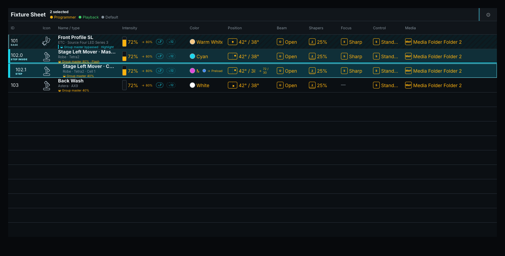
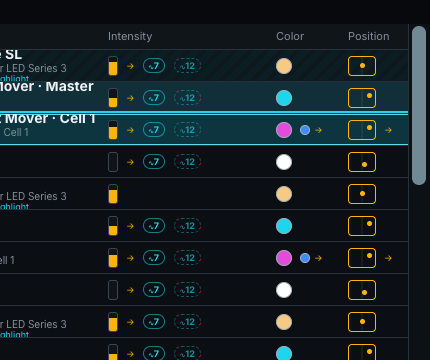
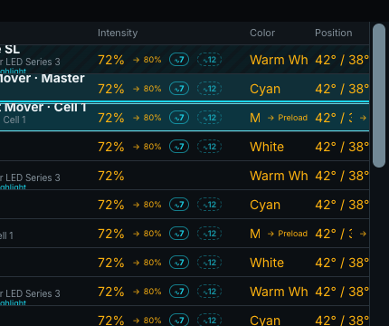
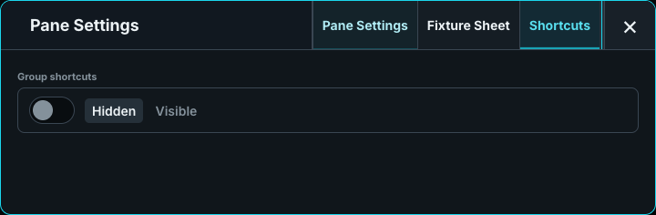
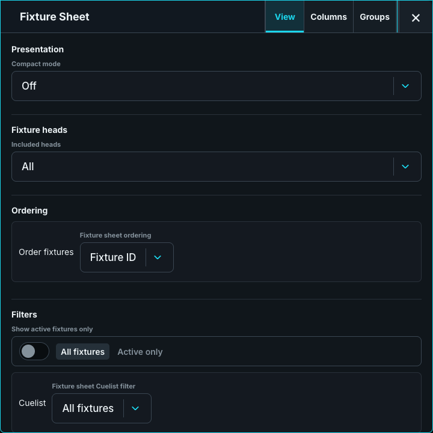
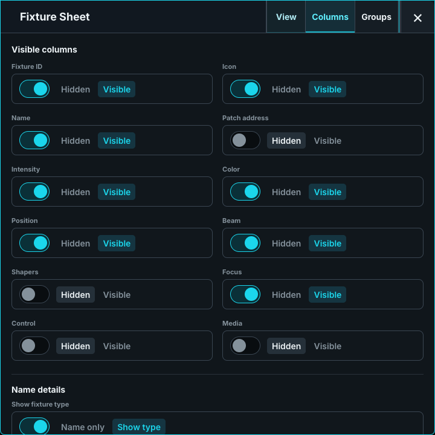

# Fixture Sheet

The Fixture sheet is the detailed programming-state inspection and selection table. Each value cell shows the winning ordinary static base before Dynamic/FAT modulation. A running Dynamic keeps its icon and pool number beside the affected member but does not replace the base with its continuously sampled value. Open **DMX output** to inspect the changing resolved DMX result. While Preload is active, the Fixture sheet adds the pending base and Dynamic identity for comparison. Activating a row selects that fixture or logical head. A compact pane shows every eligible row in Fixture ID order and scrolls when the rows exceed the available pane height.

Venue fixtures, `visual_only` profiles, and complete fixture IDs beginning `0.` remain in Show Patch, Stage, selection, MVR, and the portable show but never appear as Fixture sheet rows. These independent scenery checks run before active-only, Cuelist, ordering, and head filters. An authoritative selection containing only hidden scenery therefore selects no unrelated Fixture sheet row.

Simple fixtures use one row. Multi-head fixtures can expose a `.0` master row for shared parameters and `.1`, `.2`, and following logical-head rows for the individual heads.

During PREV/NEXT stepping, every row in the remembered base selection remains visibly selected with a subdued patterned treatment, while the actual current fixture or head uses the prominent selected treatment and a stronger left marker. This distinction does not rely on color alone and remains visible whether HIGH is off or on. PREV and NEXT move the prominent marker without hiding the base; ALL restores ordinary complete-selection styling, and an external selection replaces both indications. Multi-head state appears on the actual subhead rows. When subheads are hidden, the visible master row retains a contained-base or contained-step indication so the active state is not hidden.

### Fixture sheet columns

| Column | What it shows |
| --- | --- |
| **ID** | The fixture number. Multi-head targets add `.0` for the master and `.1` onward for logical heads. |
| **Icon** | The fixture profile's stage icon. This column normally appears between ID and Name. |
| **Name / type** | Operator name with optional manufacturer/mode. An assigned Group-master badge shows its effective fader/Flash state and explicitly reports when live Highlight output bypasses it. |
| **Patch** | The fixture's universe and address, or **Unpatched**. This dedicated column is off by default. |
| **Intensity** | The ordinary base level as a meter and percentage. During Preload, an arrow shows the pending base percentage. |
| **Color** | A color swatch and label. An explicit retained Color Preset reference shows its Preset name; other colors use a nearest known name in angle brackets, such as `<Red>`. Matching values alone do not create a Preset reference. Every swatch has the same thin light-grey boundary so black, dark, bright, absent, and mixed colors remain distinct from the table without changing the resolved fill. During Preload, a second swatch identifies the pending color. Fixtures without color parameters show the neutral fallback. |
| **Position** | A position glyph and pan/tilt values. Fixtures without position parameters show a dash. During Preload, the pending pan/tilt values appear below. |
| **Beam** | Authoritative semantic Beam bases such as an open state or indexed gobo. |
| **Shapers** | Authoritative framing/shaper member bases. |
| **Focus** | Authoritative focus, edge, frost, or zoom member bases. |
| **Control** | Authoritative semantic fixture-control bases without exposing raw DMX. |
| **Media** | Distinct Media Folder/File and, where supported, Mask Folder/File base pairs. |

The **Columns** settings independently control ID, Icon, Name, Patch address, Intensity, Color, Position, Beam, Shapers, Focus, Control, and Media. At least one column remains visible. Existing saved **Dimmer** visibility migrates to **Intensity**; newly available group columns do not turn themselves on in an existing layout. Source styling distinguishes current Programmer, Playback, and profile-default bases.

Freeze state appears in the Name cell as a blue snowflake status that is separate from selection,
Highlight, Group-Master limitation, and patch state. `❄ FREEZE` is a full-output Freeze;
`❄ FREEZE · Intensity · Color` (with the applicable family names) is a partial Freeze. A master row
shown without its frozen subheads adds `INSIDE` so the state is not hidden by the head filter.

A column only reports attributes the lantern actually carries. A fixture without colour or without Position shows **—** in that column with no colour swatch and no position crosshair, so a frost-only or dimmer-only lantern is never given a preview it cannot honour. Where the lantern does carry the group and nothing drives it, the column shows the profile home value: physical white for colour and the default pose for Pan and Tilt. Pan and Tilt read in degrees as the pose the fixture is actually commanded to, the same value the Pan and Tilt encoders show; where that pose is not known the column shows **—** rather than a channel percentage.

**Pane configuration:** **Fixture Sheet → Compact mode** has exactly **Off**, **Icon only**, and **Text only**. Off keeps the detailed 43 px presentation. Icon only uses deterministic 32 px rows, retains graphical base/Preload summaries, and removes ordinary value text. Text only uses the same 32 px rows, retains concise semantic base/Preload text, and removes decorative value graphics. Both compact modes narrow the ID column to 64 px and use a shorter 26 px table header; Icon only draws a smaller 20 px intensity meter with 4 px of space above and below it. Both compact modes keep Dynamic identities, source ownership, Group-master/Highlight status, fixture type, selection, and step markers. Configured columns are never dropped at a breakpoint; a small pane scrolls horizontally when the selected set still cannot fit. Each pane, the full built-in, and each fixed external Fixture Sheet persist their own desk-local mode, defaulting to Off without changing portable show data.

**Show active fixtures only** limits that pane to fixtures carrying Programmer values; this is useful beside a Cuelist Pool while recording looks. **Show group shortcuts** adds the Group strip. The common size and removal controls also apply. In the full Fixture Sheet window, open **Fixture Sheet** settings and use **View** for Compact mode, fixture heads, ordering, and filters; **Columns** for visible data and optional Name details; and **Groups** for the Group strip. **Included heads** defaults to **All**. Choose **No sub heads** to show only master rows with the fixture's bare ID, or **No master heads** to show only subhead rows without indentation. There is no per-row expand or collapse button. These full-sheet choices persist with the desk layout. Ordering can use Fixture ID or put active programmer fixtures first; filters can show only active fixtures or limit membership to one Cuelist.

