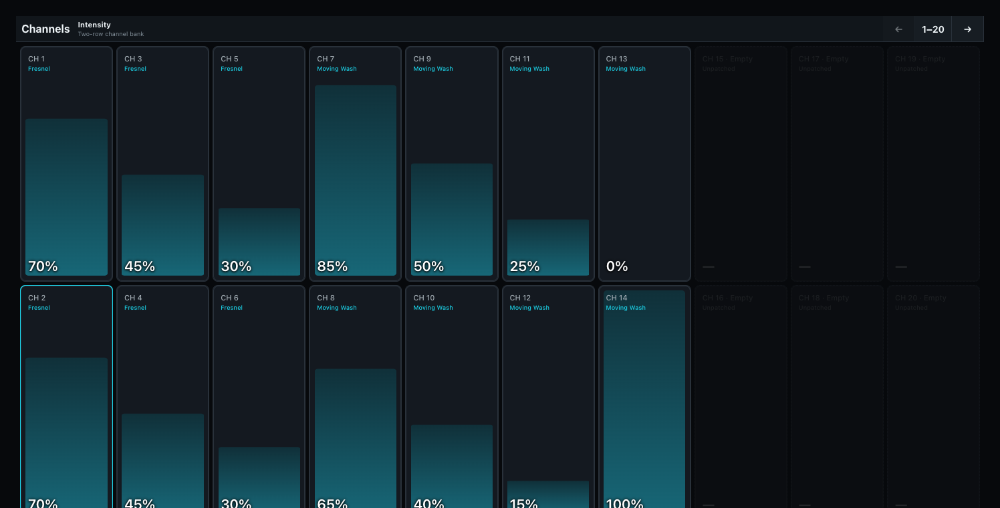

# Channel faders

Channels presents fixtures as a two-row bank of 20 intensity faders per page.

The bank lists only fixtures it can actually level: those with a dimmer channel, and those with a virtual dimmer, where intensity is derived from the fixture's emitters rather than sent on a channel of its own. A fixture with neither (a stage element such as a truss, a deck, or a set piece) is left off the bank instead of occupying a channel with a fader that could never move it. Those fixtures remain part of the show: they stay selectable and programmable, keep their place in groups and Cues, and appear in Show Patch and Stage. The [Fixture Sheet](05-fixture-sheet.md) hides scenery and visual-only entries.

Use the previous, page-range, and next controls to navigate. The page picker provides at least eight pages and grows when the patch needs more. Each populated channel shows its Fixture ID, the fixture's name, and the current resolved intensity. The name is the one the operator gave the fixture, falling back to the profile name and then to **Fixture _ID_**. A disabled fader replaces its attribute label with the current reason: an empty position, Patch loading or repair, Programmer/Preload loading, unavailable control authority, or an inactive pane. Enabled faders immediately return to their ordinary attribute label.

Touching a populated channel selects its fixture. Moving its fader writes that fixture's intensity into the desk's Programmer; it does not record a Cue or change the fixture patch. Clear or record the programmer deliberately after using the bank.

Channel numbers are sequential positions in this view, not DMX addresses. Use **DMX** when diagnosing universes and physical slot ownership, and **Fixtures** when individual logical heads and non-intensity attributes matter.

The compact Channels pane does not show page controls and remains on channels 1-20. Open the full Channels built-in for other pages.

## All channels

Choose **Pane Settings > Channels > All channels** to show attributes in profile order, grouped by Fixture ID. Each fader names its fixture and attribute. **Intensity only** returns to one level fader per fixture.

The full Channels window offers the same choice in **Channel Settings**, with a faders-per-row setting. The compact pane keeps its first bank; use the full window for page navigation.

The [programmer command line](../20-Programmer-and-Cues/01-command-line.md#setting-values-and-recording-presets) provides numeric intensity and non-intensity entry. A Channel fader and a command both change temporary Programmer values until recorded.
