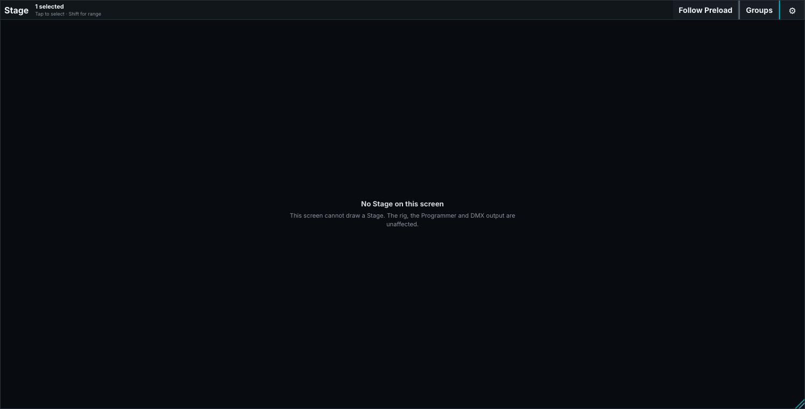
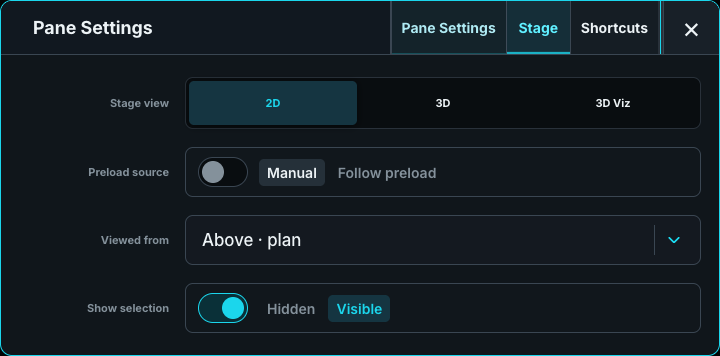

# Stage and Visualizer in Control

Control Stage provides a **2D** rig plan and a lightweight **3D** wireframe view. Both use the show's saved fixture and scenery positions. The 3D view can show **Beam direction guidelines** for aiming. Full lighting, haze, and shadows are shown in the [separate Architect Visualizer](../../10-ToskLight-Architect/11-visualizer.md).

## Select and inspect fixtures

Tap or marquee fixtures to select them. Shift extends selection; Control/Command toggles it. **Follow Preload** shows the pending look, while another Stage view can remain Live. Each pane keeps its own camera and view.

The Stage window and custom Stage panes offer **Select fixtures** and **Navigate**. Navigate changes the encoder bank to camera controls: **Position** supplies X/Y/Z and Zoom; **Direction** supplies Pan/Tilt. These controls move the view without moving the rig.

Drag to orbit, scroll to zoom, middle-drag to pan, and secondary-drag to slide. An unavailable Stage does not stop programming or DMX output.

## Configure the view

Pane Settings selects **Stage view**, **Follow Preload**, and **Show group shortcuts**. **Floor grid** adds metre-spaced reference lines. In 3D, **Beam direction guidelines** shows aim without rendering light beams.

Edit installed positions and rotations in [Show Patch](../../10-ToskLight-Architect/02-Fixtures-and-Patch/02-add-and-patch-fixtures.md) or Architect. **Open Stage Renderer** in Show Patch opens the separate Visualizer for rendered feedback. Venue scenery stays in the shared rig and has no DMX output.

## Render a 4K image

Choose **Render 4K** to freeze this pane's camera and selected Live or Follow Preload look for an image. With Stage focused, use **Cmd+Shift+R** on macOS or **Ctrl+Shift+R** on Windows/Linux.

[4K image rendering](../../10-ToskLight-Architect/90-Advanced/03-snapshots-and-4k-images.md#render-a-4k-image) covers native Ultra rendering, framing, progress, and saved images. Ordinary Control Stage stays a wireframe view. Close the separate Visualizer when it is not needed.

