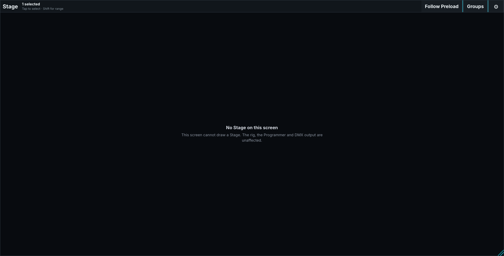
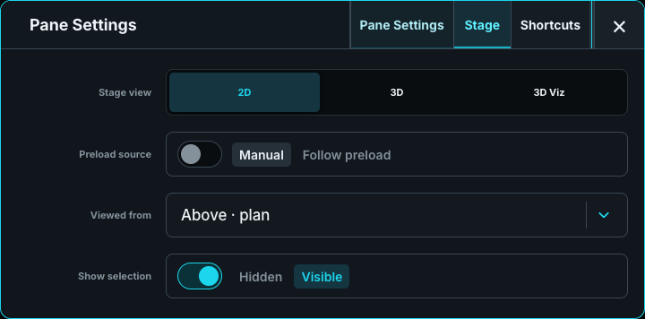
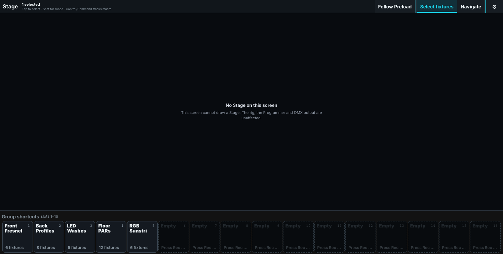

# Stage and Visualizer in Control

The Stage is the spatial selection and visualization surface. In 2D it shows fixture symbols, position, color, intensity, and direction. In 3D it renders patched fixtures, multi-patch physical instances, beams, and visual-only Venue fixtures. Tap or marquee fixtures to select them; Shift extends a range and Control/Command toggles fixtures. **Follow Preload** changes the Stage from live output to the pending Preload visualization.

**Pane configuration:**

- **Stage view** selects 2D or 3D for this pane.
- **Follow Preload** makes this pane a dedicated preview surface while another Stage pane can remain live.
- **Show group shortcuts** adds the Group strip.
- The common size and removal controls apply per pane.

Drag to orbit, scroll to zoom, use the middle button to pan, and use the secondary button to slide
the view. **Follow Preload** shows the pending values where present; a preloaded Dynamic remains
live because it is a running function. **2D** is the rig plan, **3D** is the model-and-aim view,
and **3D Viz** adds the rendered light picture. A clearly reported unavailable Stage never affects
programming, playback, or DMX output.

### Stage is a selection and viewing surface

Only the full Stage window exposes **Select fixtures** and **Navigate**. A Stage pane reflects the global mode, but it does not contain the controls that switch it.

With **Navigate** active, the desk's ordinary encoder bank replaces the Programmer attributes. On
the renderer camera, **Position** provides X, Y, Z, and Zoom; **Direction** provides Pan and Tilt.
The software encoders use the same tap, drag, wheel, arrow-key, and direct-value interactions as
the Programmer encoders. Attached encoders turn in fine steps, press-turn in coarse steps, and
open the same direct-value editor when pressed.

Positions are edited in **Show Patch**: physical patch and multi-patch placement provides every fixture's location and rotation, with **Open Stage Renderer** for visual feedback while patching. Add a truss, platform, curtain, or other scenery object from the **Venue** manufacturer in **Show Patch**; these visual-only fixtures receive `0.x` fixture IDs and no DMX address.

A Stage pane stores its own view and side independently, so a Live pane and a **Follow Preload**
pane can look at the rig from different places.

**Render quality** applies to the 3D Viz view and is a ladder of what is in the beam, each tier
adding to the one below it:

- **Draft**: the light cones, and nothing in them.
- **Standard**: and the gobos, so a projected pattern is a pattern rather than a plain cone.
- **High**: and the fall-off: a feathered field edge, the light dropping away across the pool, and
  shadows where a beam meets something opaque.
- **Ultra**: and the haze itself, drifting and uneven, so a beam through it varies along its
  length instead of running through a uniform slab.

On a fresh desk, **Environment brightness** starts at 5%, leaving an unlit rig just visible without
flattening the fixtures' output. Changing it is persisted with the desk layout; an existing saved
value, including zero, remains authoritative when that layout is reopened.

**Floor grid** lays a dark reference grid of lines on the ground plane, a metre apart, with the
centre lines drawn stronger. It is lines rather than a surface: it takes no light and hides nothing
under it.

**Background** is the colour behind the rig (the room rather than the show) and applies to every
Stage view. It is very dark and slightly blue by default.

Exposure is fixed. The Stage does not adapt to how much light the rig is producing the way an eye
does, because a desk has to answer "how bright is this" with the same picture every time: taking a
rig down has to look like taking a rig down, across the whole of the fader rather than the bottom
of it. The **Exposure** trim is the operator's own multiplier over that.

With fixture labels enabled, **UV** beside a fixture number means native UV drive is active. A small steady triangle means its visible color prediction is estimated or incomplete. These optional marks include every head, including a UV-only head. Stage shows known visible output; it does not replace ultraviolet with purple or simulate fluorescence. The marks do not open messages or interrupt programming.

Stage receives authoritative Live and Preload output from the engine. A disconnected view freezes its last coherent state and reconnects without blocking Programmer, Playback, command handling, or physical output.

