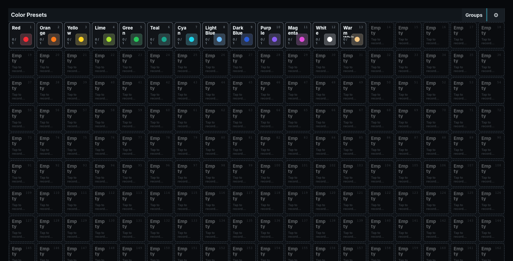
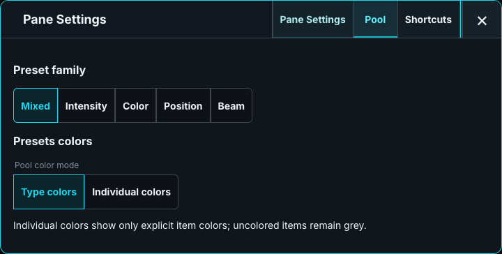
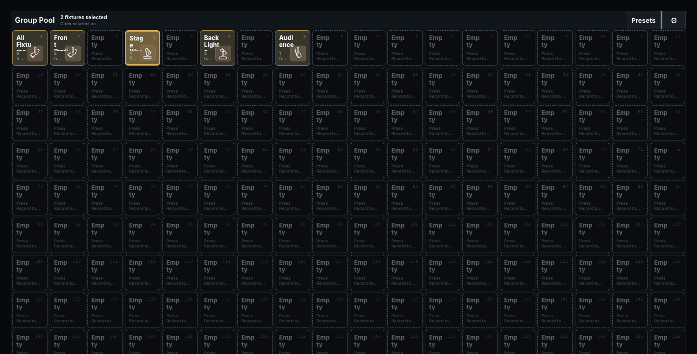

# Group and Preset pools

## Preset pool

The Preset pool recalls reusable attribute values into the programmer. Intensity, Color, Position, and Beam presets contain only attributes from that family. A Mixed preset can contain any combination of attributes. A preset does not execute a Cue by itself. Tap a populated tile to apply it to the current fixture selection. [Record and Update](../20-Programmer-and-Cues/01-command-line.md#choosing-how-to-record-rec-rec) apply to the chosen target.

Each tile shows its number, title, family, icon or artwork, and the number of fixtures currently showing its values. The pool provides at least 200 numbered positions and grows to include the highest stored preset number. Filtering to one family disables tiles from the other families instead of deleting or renumbering them.

**Pane configuration:**

- **Preset family** selects Mixed, Intensity, Color, Position, or Beam for this pane only. Mixed is a family for presets containing any combination of attributes; it is not an aggregate list of the other families. Two Preset panes can therefore show different families.
- **Type colors / Individual colors** chooses the color source for this pane. Type mode uses the configured Preset-family default. Individual mode shows only an explicit button color and leaves uncolored tiles grey.
- **Show group shortcuts** adds the Group strip below the pool so fixtures can be selected before a preset is recalled or recorded.

The full Presets window additionally exposes family buttons and pool-color settings in its header. With Set armed, tapping a preset opens its local button presentation settings: title, icon, and button color. Those presentation choices are stored in desk data, scoped to the active show identity, and do not change the stored preset values.

In **Desk Setup → Preferences → Defaults → Pools** or **Desktop settings**, two values control the square tile size for Groups, Presets, Cuelists, Macros, and Dynamics pools:

- **Default pool tile width (px)** is the width a pane fits its columns to. Tiles stretch to fill the row. The default is 72 px, allowing three columns in a pane about 225 px wide. Larger values show fewer columns.
- **Minimum pool tile width (px)** only applies when stretching would make tiles wider than 1.5 times the default width. The pane then adds one more column, as long as its tiles stay at least this wide. The default is 56 px. A minimum above the default width is treated as the default width.

Tiles narrower than the default width show their text at 80% size. Both values are saved with the desk layout; a layout saved with the earlier single tile width uses that value as its default width. A Group pane with an explicit **Columns** value keeps that column count.

## Group pool

The Group pool stores ordered fixture selections. Order matters for operations such as value spreading, and an intentionally stored empty Group remains different from an unused pool position. Tap a populated Group to select its current ordered members and place that Group reference on the command line, ready for an operation such as **DIV**. Normal Record stores an empty target or merges into an existing Group. See [Groups](../20-Programmer-and-Cues/03-groups-and-presets.md) for one-off options.

A populated tile shows its number, name, member count, and selection state. Hold a Group to open its name, icon, color, Projection, and Phase settings. Create a Group Master by [assigning the Group to a playback](../20-Programmer-and-Cues/25-playback-configuration.md).

**Pane configuration:** **Type colors / Individual colors** chooses the shared Group default or explicit item colors for this pane. Common size and removal controls also apply.

## Reading pool tiles

The name starts at the top left; the grid number is at the top right. Long names wrap without an inner scrollbar. The number and bottom-right icon or preview have backgrounds with faded edges so they remain readable above the name.

| Pool | Bottom-left information |
| --- | --- |
| Cuelists | Number of Cues, with a small play symbol when running on any playback. |
| Groups | Fixture count, or selected/total when some members are selected. |
| Presets | Number of fixtures currently on that Preset. |
| Timecode | Unarmed, Armed, or Playing. |
| Dynamics | Number of fixtures currently running that Dynamic. |

While Record is armed, a red rounded badge with bold black text spans the bottom of the tile above its other contents. **REC** means Record, **REC MRG** means Record Merge, and **REC CUE** means record the next Cue. The badge describes the current target and chosen mode. A one-Cue Cuelist showing **REC** still asks Add, Merge, or Overwrite when touched; the label is not permission to overwrite automatically.

Update has its own bottom overlay and target eligibility feedback. Switching between normal, Record, and Update modes leaves the name, number, and information in the same positions. An armed overlay can cover bottom information temporarily. Dynamics are operated or edited through their own controls; their lane symbol does not make them an ordinary Record or Update target.
