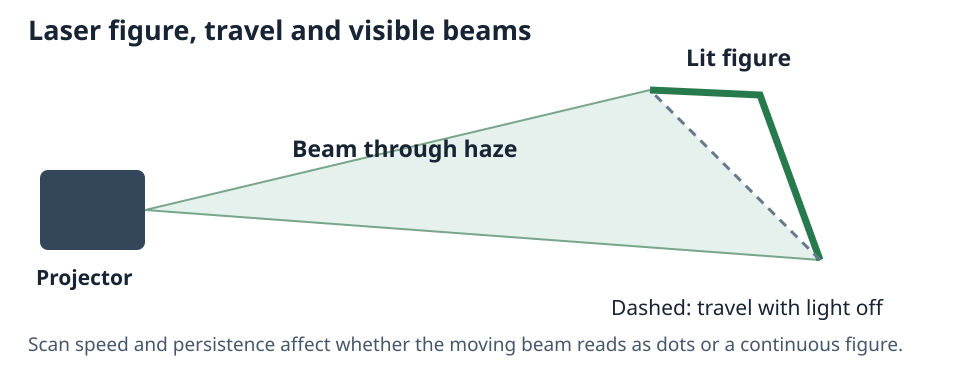

# Lasers

A laser profile needs its own packaged pattern engine to draw the projector's actual DMX patterns.
A profile marked as a laser but missing that engine stays dark; the Visualizer reports why.
Check the fixture profile and mode before judging the simulated pattern.

## Aim the projector

Set the installed position, rotation and **Bracket** angle in the patch. These aim the physical
projector. Its DMX position channels usually move a figure inside the scan field; they do not
turn the chassis like a moving head.

The **figure** is the path on a surface. The **beam** is the light through the air; reduce haze and
that beam fades while the surface figure remains. Blanked travel moves between lit segments
without drawing a connecting line. Scan speed affects how continuous the figure appears.

## Adjust the preview

In **Quick Settings**:

- **Laser brightness** adjusts every laser from off to four times the normal drawn strength.
- **Persistence of vision** sets how long a flash takes to decay. Use zero to inspect only the
  instantaneous values; a short persistence makes strobes and scanning figures read more naturally.
- **Persistence falloff** shapes that decay. Higher values remove the dim tail faster.

These settings belong to this Visualizer on this computer. They do not change the show or the
physical projector's output. The simulation is a visual preview, not a measurement of exposure.

Fixture-package authors configure pattern engines and optical data in the fixture profile;
operator programming still uses its ordinary DMX mode.
