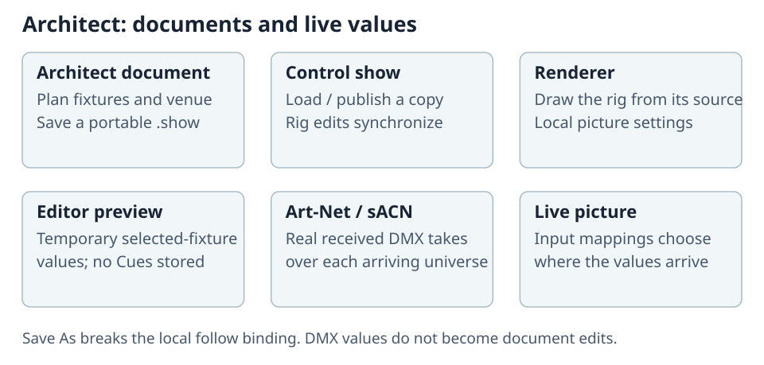

# Plan a Rig and Move It

Architect prepares the rig, venue and drawings in a portable `.show` document. Use Control to
program Cues and Playbacks. The editor's lighting preview checks a rig without creating programming.

## Open Demo Show

Choose **Show > New Show > Open Demo Show** for a complete rig with fixtures, scenery and media
surfaces. Every press creates a writable copy named **Demo Show**, **Demo Show 2**, and so on;
the bundled template is never changed. A new installation opens a copy automatically.

## The Show screen

Use the file actions at the top of **Show**:

| Action | Result |
| --- | --- |
| **New Show** | Create an empty document or a Demo Show copy. |
| **Open** | Load a file, a recent document, or an active show discovered on Control. |
| **Save As** | Open a new, independent copy with its own identity. |
| **Publish to ToskLight Control** | Add this document to a discovered desk's show library and follow that copy. |
| **Import MVR / Export MVR** | Exchange the rig with other planning applications. Review the import or export limitations. |

**Load Recent Shows** lists existing files, newest first. **Load from ToskLight Control** lists
discovered desks with an active show; it has no manual IP entry. When discovery is unavailable,
transfer an ordinary `.show` file instead.

Click the pencil beside the show name to rename it. Enter or clicking away accepts; Escape
cancels. The filename stays unchanged. For a document following Control, this local rename does
not rename the desk's library entry.

Under **Show information**, enter the project, venue, date, version and lighting designer's
contact details. Edits save automatically to the open show and appear in printed title blocks.
Wait for **Saving project information…** to finish before closing the document. A failed save keeps
your draft and offers **Retry saving project information**.
**Upload logo** accepts PNG, JPEG or WebP up to 10 MB. **Replace logo** and **Remove logo** are also
saved automatically. **Make Default** keeps the designer details and logo on this
computer for future **New Show** documents; it does not change existing shows.

## Stay in step with Control

**Load from ToskLight Control** copies the active show and follows that desk. **Publish to
ToskLight Control** starts following the published copy once Control opens it. Rig edits move in
both directions automatically; there is no separate Save to Control. Programmer values, selection,
Highlight, Cues and Playbacks remain Control's own.

Edits are saved locally before transmission. After a network loss, they wait until the same show
is active on that desk again. **Save As** creates an independent document without this binding.

| Status chip | What to do |
| --- | --- |
| **Synced** | Control has every edit. |
| **N pending** | Edits are saved here and waiting to reach Control. |
| **Offline / Show not active on Control** | Restore the connection or open the followed show on Control. |
| **N conflicts** | Open the chip and choose **Keep Control's** or **Use mine** for each conflicting edit. |
| **Sync error** | Open the chip, read the reason and correct it. Use **Discard my change** or **Send again** where offered. |

Changes to different fields are kept together. If both operators change the same field,
Control's version remains visible until you resolve the conflict; your version is retained.
**Work offline** pauses communication; **Reconnect** catches up. Control shows an **Architect** synchronization indicator
beside its show name while Architect follows it.

On Control, **Load Show > Load from Visualizer** imports and opens the editor's current document.
An editor without an open document has nothing to offer.

## MCP integration

**MCP** in the Show title opens its integration settings. Connected tools act on the open show,
subject to the same sizes, patch rules and revision checks as the editor. Review proposed edits
before running them; the CAD and patch update with accepted changes.

## Configure fixtures

Open **Settings > Library** to choose a manufacturer, fixture and mode, inspect its specifications,
or use **Create Fixture** / **Edit as new revision**. The library belongs to this computer.
A show keeps its embedded profile revisions until you explicitly update its fixtures.
See [Fixture Types and GDTF](../10-Desk/10-Show-Setup/11-fixture-types-and-gdtf.md) for profile editing.

The **Patch > Sheet** tab lists DMX fixtures. Turn on **Show all** to include visual-only Venue
objects. Selecting a Venue object in CAD also turns it on. **+ Add fixture** adds from the library;
**+ Import 3D model** imports a venue model.

Click a column header to sort; click again to reverse. Empty values sort last. Shift selections
follow the displayed order. Under the title's **Settings > Columns**, choose columns or a
**Patch**, **Visualization** or **Compact** quick view. Changing individual columns produces **Custom**.

Right-click a value to edit it. If that fixture is selected, the edit applies to the selection;
otherwise it selects and edits that fixture alone. Check the selected rows before confirming.

| Field | Use |
| --- | --- |
| **Fixture ID** | Renumber; an open range such as `1100 THRU` counts upward, `1101 THRU −` downward. |
| **Location / Rotation / Bracket** | Place and aim the fixture. |
| **Footprint / Colour** | Size and colour adjustable Venue objects. |
| **Chain** | Plain chain, motor on top, or motor on bottom. |
| **Scale** | Resize a Venue model from 0.01× to 100×. |
| **Masters** | Choose `none`, `group`, `grand` or `both`; heed the warning if a fixture bypasses a master. |
| **MIB** | Disable Move in Black or set its delay from 0 to 30 seconds. |
| **Note** | Add a rigging or production note. |

Select a layer to limit sheet selection to it. **All fixtures** removes that limit. Deleting a
layer retains its fixtures under **No Layer Assigned**; unlock a locked layer first. Deleting
fixtures removes them from the show. **Unpatch** retains them and their programming but clears
DMX addresses. Locked-layer fixtures are excluded from a multi-fixture deletion.

### Repatch on the DMX grid

Open **Patch > DMX**. Each fixture's occupied cells share an outline; orange cells indicate address
overlap. Select a cell for the owner, attribute, patch range and DIP-switch setting.

With **Show sidebar** on, drag a block to another address or patched universe. Each split or
multi-patch copy moves independently. Moves appear dashed and are listed under **Pending patch**.
Choose **Apply Patch** to save them together or **Discard** to revert. A refused move remains
pending with its reason. **Sheet** returns to the fixture table.

## Preview lighting without a desk

Select fixtures and use **Simple** for Intensity, Pan, Tilt, Colour and Gobo. **Full DMX** exposes
all slots when exactly one fixture is selected. **Clear** restores the selected fixtures' defaults.
These are temporary preview values: closing the document discards them, and they never become
Cues or Presets.

Real Art-Net or sACN takes over each universe as soon as it arrives. Other universes retain their
preview. When the source stops, the renderer holds its last received frame; it does not jump back
to the editor preview. The status line identifies preview, waiting and live-input states.

## Receive live DMX

Open **Settings > DMX > Network**:

1. Choose an **Art-Net interface** and **sACN interface**, independently. **All interfaces** is the
   default. A missing chosen interface shows **not connected** and does not fall back silently.
2. Add live-input mappings from logical show universe to protocol, wire universe, delivery mode
   and port. Art-Net offers Broadcast/Unicast; sACN offers Multicast/Unicast.
3. Press **Apply** to store the mappings in the show, or **Cancel** to discard the draft.

**Take from Desk** previews compatible routes from a detected desk; choose a desk first when
several are available, then **Apply**. Explicit show inputs override derived routes for the same
logical universe. Interface choices stay on this computer.

**Values** shows received levels, sender, rate and **Holding the last frame** / **Waiting for DMX**.
Select a channel for its value and fixture. **Sources** lists discovered Art-Net nodes and sACN
sources; a silent or non-discoverable device may not appear. These diagnostics listen only while
open. Architect sends no DMX.

While the renderer follows the editor, these show inputs govern it. Its own per-universe Quick
Settings overrides apply only when following a desk or an independently opened show file.

## Work in CAD

The title contains **Undo**, **Redo**, placement tools, drawing tools, **Plans**, **Elements** and
**Settings**. Hover or focus an icon for its name and shortcut.

### Place stage and scenery

Use **Add truss**, **Add stage element**, **Add scenery**, **Add primitive**, or **Add venue element**.
A button places its current part; its caret chooses another. A placed object is selected, ready for
**Info > Placement** to set position, rotation, size and options. Venue objects receive `0.N` IDs
and have no DMX address.

- **Place Multiple**, beside a truss or stage deck, previews a complete arrangement before **Place**.
  A truss run uses first/last points and a section count. Different endpoint heights produce a
  stepped run, not tilted sections. A deck grid uses orientation, counts across/deep and its centre.
- **Add Several (++)** holds a part for repeated click placement until Escape or **Done**.
- **Load model…** imports GLB, glTF, 3MF or OBJ; see [Place your own venue models](#place-your-own-venue-models).

Adjustable parts use the size and options in **Placement**, rather than a separate part for every
size. For example, set a curtain's width/drop, a stage deck's height, a chain's motor end, or a line
array's element count there.

### Draw walls and fit openings

**Draw wall**, beside **Draw line**, draws a connected run: click the start and each corner, then
Escape to finish. It snaps to existing corners, points along walls, and horizontal/vertical/45°
directions. Hold Shift to disable corner, wall, angle and loop-closure snapping.

Use its dropdown for windows, doors, pillars and stairs. With a window or door active, hover a
wall to preview the opening, then click to attach it. Escape ends repeated placement.
Select the wall or opening and use **Info > Placement**:

| Object | Main settings |
| --- | --- |
| Wall | Length, height, thickness, colour and room ceiling height. |
| Window | Width, height, sill and rectangular, round or arched shape. |
| Door | Width, height, single/double leaves, inward/outward swing and hinge side. |
| Pillar | Round, square or rectangular footprint and dimensions. |
| Floor, roof or balcony | Outline, elevation above floor and slab thickness. |
| Stairs | Width, rise, run and step count. |
| Furniture | Table shape/size, chair style, or bar dimensions. |

Openings move with their wall. Overlapping openings or openings outside it are refused.
**Snap endpoints to nearby walls (25 cm)** can close a nearby endpoint when placing/applying a wall;
turn it off for a deliberate gap. Connected segments appear as continuous walls in plans and 3D,
while remaining individually selectable and colourable. Enclosed walls create a ceiling at the
lowest requested **Room ceiling height**.

Slab outlines need at least three non-crossing points. Edit local X/Depth points, add/remove points,
then position and rotate the whole slab. Elevation is measured from its placement's floor datum;
duplicate and raise balconies for stacked levels. Stairs rise along positive local Depth; rotate
them with **Angle**. Stairs intersecting a floor or balcony create a cutout automatically, which
follows later stair edits.

Top views draw wall outlines. Side views outline obstructing near walls so you can see and select
the interior. Exported plans retain the venue. In 3D, a camera outside an enclosed room hides
obstructing near walls and ceilings; from inside they remain visible. Cutaway surfaces still block
light and cast shadows. Windows and doors are real openings. Balconies remain visible.

### Edit the selection

**Info** follows the selection at the right of CAD. **Generic** holds name, notes and patch;
**Placement** holds position, rotation, sizes and parameters. Fields show units. Enter or leaving
a field commits; Escape restores its previous value. Stage decks and stage stairs are positioned
at the floor under their feet; other generated scenery uses its centre.

With several elements selected, enter one value for all or `1 THRU 5` to spread in selection order.
Mixed values show their range. **Shared model** exposes common part settings only when the selected
objects use the same model. **Placement Assistant** previews Line, Grid or Circle arrangements;
**Apply** commits them.

**Update to the newest version** appears when a newer library profile is available. It retains
placement, patch and adjustable measurements; review the updated geometry before using the plan.

### Move, rotate and duplicate

Drag the gizmo's arrow along one axis or its square freely. Shift-arrow dragging spreads the
selection. Hold Option (Ctrl on Windows/Linux) while dragging the gizmo to duplicate; release the
modifier before the pointer to move instead. Copies have new IDs and are unpatched.

The amber arc rotates about the view axis in 15° steps; Shift allows free rotation. Several
selected elements rotate around their shared centre. During a move, type a coordinate, or start
with `+`/`−` for a relative distance. Tab changes axis during a free move; Enter commits. Typed
moves do not snap or spread. Escape clears typed input, then cancels the drag.

With **Settings > Enable snapping** on, the gizmo snaps compatible truss connectors, stage edges,
curtain rails/ends, handrail feet and fixture mounting clips. Only movable axes change. Shift
suppresses snapping and automatic fixture mounting. A plan drag cannot snap a floor fixture to a
truss far above it; use an elevation to set height.

Right-click a selected object for **Group**, **Ungroup**, **Duplicate** and **Delete**. A single
Delete acts immediately; several selected objects require confirmation. Undo restores their IDs,
patch and placements. A multi-patch copy's **Info** edits that copy's placement; dragging the
fixture in CAD moves its copies together. Notes and scale are shared across copies.

### Group venue objects

Under **Elements > Objects**, select at least two Venue elements and choose **Group** (Cmd/Ctrl+G).
Clicking any member selects the group; Shift selects individual members. Violet outlines mark a
whole selected group, blue an individual element. **Ungroup** (Shift+Cmd/Ctrl+G) dissolves touched
groups without moving their parts. Each element belongs to at most one group.

### Draw and measure

| Tool | Operation |
| --- | --- |
| **Select (V)** | Select and move objects or placed text. |
| **Draw line (L)** | Click points; Enter, double-click or right-click finishes. Click the start to close. |
| **Draw box (P)** | Click opposite corners. |
| **Place text (T)** | Click, type and Enter. Select later to change words, height, font or position in Info. |
| **Measure (M)** | Drag endpoints; read millimetres below 1 m, metres above. |
| **Erase (R)** | Click an annotation to remove it. |

With snapping on, drawing points prefer nearby object corners, horizontal/vertical alignment and
10 cm coordinates; Shift draws freely. Measurements snap to connectors, corners, curtain ends
and centres. Escape cancels unfinished work; a second Escape returns to Select. Middle mouse or
Alt pans. Drawing tools are unavailable while print pages are open.

**1–5** selects the five plan/elevation views, **+/−** zooms and **W/A/S/D** pans. Shortcuts are
ignored while typing. **Settings > Grid** controls visibility, colour, automatic/fixed spacing and
the quarter-step sub-grid. These preferences belong to this computer.

## Import a venue drawing

Open **Elements > Drawings > + > Import drawing (DXF, SVG)…**. Check the reported units, dimensions
and line count, set its view axis, origin, scale and rotation, then **Place Drawing**. Verify a
known distance, such as stage width. Drawings travel inside the show; no original file is needed.
Supported geometry includes lines, polylines, circles, arcs, ellipses and blocks. Text, dimensions,
hatches and splines are not imported.

Use folders and drag rows in **Drawings** to organize imports and annotations. Select an imported
drawing to adjust its placement, hide it or remove it. Deleting a folder retains its contents.
Drawings appear only on their matching view axis and are not clipped by cut planes.

## Compose and export plans

Plan frames remain visible when you turn their CAD viewport. Each sheet keeps its saved view
rotation, so the frame, labels and title block turn together relative to the rig. The Plans list
shows that rotation. Use **View rotation** in the selected page settings to change the printed
view while keeping its centre. **Rotate page** changes the paper between portrait and landscape.

**Plans** holds print pages and fixture-list pages. Set project and designer details on **Show**;
these supply every page's title block. Plans use the same fixture poses, wall joins and drawing
geometry as CAD. **Mounting hardware** in a page's settings hides fixture clamps where supported.

Set **Page title** in the selected page settings. Pages, titles, inclusion, framing and view
rotation are saved in the portable show document and travel with **Save As**. Existing pages
from this computer are adopted once when the document has no saved pages. Wait for page saving
to finish before exporting; a failed save offers **Retry saving pages**.

Use **Delete page** to remove the selected sheet. **Fixed scale** locks a plan to its **Scale 1:**
denominator, including after paper rotation. The frame can still move; unlock it to resize freely.

The title block prints the page title above the project or show name, then the venue and
lighting designer's details. Missing phone and email rows are omitted. The right side holds
the **Printed** timestamp, fixture and universe counts, scale and logo. A gray footer identifies
ToskLight Architect and www.tosklight.de. The scale also appears in the separate left footer.
The application shows white text on a dark block; PDF output uses black text on white.
The default vector logo retains its blue accent in both.

Top plans place the audience at the bottom; elevations look from their named direction. The
viewport's orientation mark follows a rotated plan. Lens direction indicators show the fixtures'
installed aim. Objects following a Control **3D Point** remain at their authored rig position in
CAD. **Settings > General > Show fixture IDs** also shows their reference labels; select an
object to read its full reference in Placement Info without covering the plan.

Use the viewport's **From / To** cut planes to omit obstructing scenery. Top views cut by height,
elevations by depth. Empty limits are unrestricted; **Show all** clears the cut. Objects wholly
outside the slice are hidden and cannot be picked. A page created from the viewport retains that
slice. Each page also chooses which drawings on its axis to print.

## Place your own venue models

Use **Add primitive > Load model…**, **Elements > + > Import 3D model…**, or the Patch import action.
The imported model is placed at the stage origin and selected. Set its placement and scale in Info.
It travels inside the show and can be placed again from **Imported models**.

| Format | Prepare before import |
| --- | --- |
| GLB | Self-contained glTF 2.0 binary. |
| glTF | Keep buffers/textures beside the file; export without Draco or meshopt compression. |
| 3MF | Declared units and build placements are respected; converted upright from Z-up. |
| OBJ | Metres, Y-up; keep its `.mtl` beside it. |

Surface colours are supported, textures are not. The packed model must fit within 64 MB and two
million triangles. A rejected file reports the reason and adds nothing. Reimporting a changed
file creates a new object; it does not replace existing copies.

## Review an MVR before importing

Read the preview's **Import limitations**, profiles, modes and addresses before applying.
Fixtures without usable profiles may be retained unresolved for later repair or skipped; changing
an address cannot repair a missing profile.

A conflicting profile revision blocks import unless you choose **Import conflicting profiles as
new identities**. That choice retains the existing profiles and imports separate copies. Review
any fixture-specific calibration that needs revalidation afterward.

Apply uses the inspected preview. If the destination patch changes, preview again. Correct address
overlap before running the rig on Control. Warnings remain available until **Done**.
