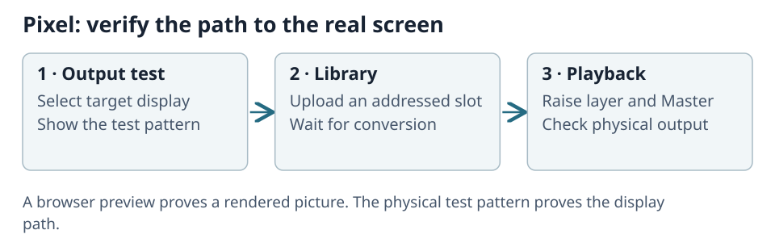

# Start ToskLight Pixel

Start **ToskLight Pixel**, then open the administration address shown on its standby picture or
status item. On the server computer this is usually `http://127.0.0.1:8080`; use the displayed
address if it differs. From another computer, use the server's reachable network address.
Pixel does not open a browser automatically.

A first launch creates one enabled **Main** output in a window. Configure its destination before
using it on stage.

## Prove the output

1. Open **Settings → Outputs**, select Main and choose the display or off-screen target.
2. Check fullscreen, resolution and presentation rate. Apply any restart-required changes.
3. Show the **test pattern** and check the physical display.
4. Turn the pattern off. In **Library**, upload one recognizable file into a numbered slot.
5. Wait for conversion, take over playback and select that slot on a layer.
6. Raise the layer and Master, then compare the isolated preview, composite and real display.
7. Release takeover when the desk should control playback.

If the physical test pattern is missing, correct the output/display settings. If the pattern works
but content does not, check the slot, conversion job, layer/Master levels and playback ownership.
With valid DMX and no visible content, the normal output is black.

## Keep configuration and media together

Under **Settings → Libraries**, **Show folder on Media Server** reveals the portable data folder.
Copy the whole folder, including configuration, media and metadata, when moving to another machine.
Stop Pixel before replacing a destination folder.

**Change folder…** selects a configuration/library folder on the server computer. If it already
contains a Pixel configuration, that configuration opens; otherwise Pixel copies current settings
there. Existing media is not copied. Pixel restarts and reconnects the page. If the chosen folder
is missing at a later launch, Pixel uses the original folder.

## Settings and restart

Settings save automatically. Headings marked **Applies on restart** have pending changes; restart
before judging them. **Revert to current settings** cancels a pending change.
See [Outputs and Displays](03-outputs-and-displays.md) for details.

If the default port 8080 is occupied, Pixel reports a free replacement port. A port you explicitly
configured is never substituted. If another Pixel is already running, open the address it reports
or stop that instance first.
