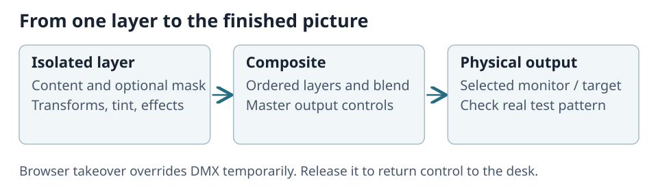

# Operate Outputs, Master, and Layers

Select the output in the dock. Its **Master** controls the complete picture; each ordered layer
supplies one part. DMX normally controls playback. Browser takeover temporarily overrides it.

## Take control and choose content

Take over the output or a specific layer before editing it in the browser. Select its numeric
content folder/file and optional mask. Content 0 or 255 is blank. Raise both the layer and Master
when checking a picture. Release takeover to return to desk control.

The isolated preview shows that layer. The composite includes layer order, blending, masks,
effects and Master. A correct layer may disappear in the composite because another layer covers
it or its blend, opacity, mask or Master suppresses it.

## Layer controls

| Tab | Controls |
| --- | --- |
| **Playback** | Play mode, dimmer, volume, speed/BPM and playback range. |
| **Frame** | Position, scale, scaling mode, rotation and 3D model/pan/tilt. |
| **Colour** | Tint and greyscale (White Blend). |
| **Mask** | Mask selection and placement. |
| **Blend** | Blend mode and strobe. |
| **Effects** | Bank 1, then Bank 2; a generated visualizer also has its own Visualizer tab. |

**Playback range** shows clip length, In point and Out point as `mm:ss.ff`. **Clear playback range**
restores the whole clip. See [Playback range](05-generated-sources-and-effects.md#playback-range)
for how the points are measured.

The Visualizer tab's four channels are separate from effect banks. Unused channels are labelled
**Unused**. The Master has output-wide geometry, mask, shapers and colour controls rather than a
content address.

## Clip loading

During a content change, the layer can hold the old clip until the new one's first frame is ready.
**Settings > Libraries > Clip switch** sets that maximum wait from 0–10,000 ms, default 500 ms.
Zero disables the hold. If the new clip is still loading after the limit, the layer becomes
transparent until ready. Blank, disabled, deleted or failed content becomes transparent immediately.
