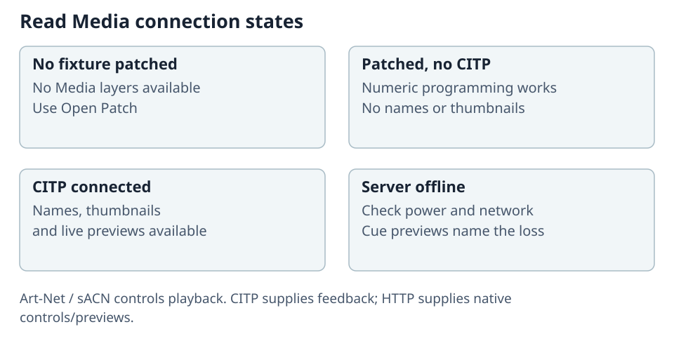

# Connect ToskLight Control to Pixel

Art-Net or sACN controls Pixel. CITP/MSEX adds names, thumbnails and live previews. The HTTP
connection supplies Pixel's native controls and media Cue pictures. Check each connection separately.

## Patch Pixel on Control

1. In **Show > Show Patch**, add **ToskLight > Media Server**, in the **2-layer** or **8-layer** mode.
2. On Pixel, open **Settings > Network & DMX** and match personality, protocol, universe and address.
3. Configure Control's real output route to Pixel's reachable address or multicast universe.
4. Raise the desired layer's Intensity, select its Folder/File and keep Master raised.
5. Release Pixel's browser takeover and verify the physical output.

Two layers occupy **158 slots**. Eight layers occupy **512**, so their start address must be **1**.
Master homes at full; layers home at zero. Unpatching retains programming but stops DMX output.

## Configure names and previews

Open **Show Patch > Media Servers**, enter **IP address** and **CITP port** (normally 4809), then
**Apply**. For a ToskLight Media row, enter its **HTTP port** too (normally 8080). Custom ports must
match the running server; CITP does not advertise the HTTP port.

**Refresh Discovery** also checks configured ToskLight Media endpoints. Select an output's
**Patch suggested** or **Patch address** where offered. Unconfigured discovery checks the standard
ports; manually configure a server using custom ports.

The Media pane remains usable without CITP: enter numeric Folder/File values. With CITP, those
addresses gain names and pictures. **No media server is patched** means use **Open Patch** first.
An unreachable HTTP endpoint produces **Media Server offline** for media Cue pictures.

Master has no content address, so selecting it opens Mask with output, geometry, mask, shaper and
colour controls. Negative scale mirrors the output. Layers provide their own content and mask.

## Follow a Control Speed Group

1. On Pixel, set **Settings > Network & DMX > Speed Groups** to a listen address such as
   `0.0.0.0:4810`.
2. For each output, set **Synchronized playback follows** to Control Speed Group **A–E**.
3. Keep Pixel's reachable endpoint configured on Control.

Pixel reports the followed desk and tempo. On loss it holds the last tempo and reports the desk
as lost; reconnection resumes following. Otherwise synchronized play modes use the layer's
**Playback BPM**.

## Program effects

Configure the numbered preset on Pixel's **Library > Effects**, then program its **Select**,
**Strength** and four parameter channels in either ordered bank. Zero uses the preset's parameter
value; 1–255 sweeps its range. Preset edits affect every bank recalling that number.
The four **Visualizer Parameters** are separate channels, named for the shown visualizer when
connected. **Default** keeps the configured value; **Unused** has no effect on that content.

## Check DMX diagnostics

Open Pixel's **DMX** diagnostics. **Listening for DMX on** shows the running protocol, universe and
start address. Each output has Master and Layer rows with their patch range and selected media.
**Selected media** is a library address, not a DMX address. Confirm the expected sender and changing
values while operating Control.

For no output, check in order: listener health, protocol/universe/destination, patch range, selected
slot, layer and Master levels, Play Mode, and browser takeover. For missing pictures/names with
working DMX, check CITP and HTTP endpoints. Apply pending restart-required settings before testing.

## Connect another console

On Pixel's **DMX > Connect to Console**, download both **ToskLight Pixel Layer** and
**ToskLight Pixel Master** for MagicQ, grandMA2, grandMA3 or GDTF. Patch one 59-slot Layer fixture
per configured layer, followed by one 40-slot Master—not one Master per layer.

| Personality | Patch from start address 1 |
| --- | --- |
| 2 layers | Layer 1: 1; Layer 2: 60; Master: 119–158. Other starts up to 355 are possible. |
| 8 layers | Layers: 1, 60, 119, 178, 237, 296, 355, 414; Master: 473–512. |

Use the running connection panel's actual universe/addresses. Restart Pixel after changing the
personality; protocol/universe/address changes apply immediately.

### Install the files

- **MagicQ:** copy both `.hed` files to `show/heads`. In **PATCH**, choose manufacturer **ToskLight**,
  add the configured Layer count and one Master. Rescan/restart if absent. An existing show keeps
  its old personality: replace that head or test in a new show.
- **grandMA2:** copy XML files to `gma2/library` and import fixture types in
  **Setup > Patch & Fixture Schedule**.
- **grandMA3 / GDTF:** import both GDTF fixture types in the console's patch interface.

Match the console's output protocol/universe. sACN universes start at 1; Art-Net consoles may show
a zero-based wire universe, so verify the actual mapping.

### MagicQ names and live preview

In **SETUP > View System > Media**, check **CITP MSEX**, first Layer head and **Layers** count.
Set Pixel's IP/CITP port, **Thumb con > Enabled**, **Live prev > Yes**, then **GET THUMBS**.
Importing a personality does not configure these settings for you.

The normal Media preview is the program output. Hold **SHIFT** and press **VIEW SERVERS**
(**PREVIEW LAYER**) for the selected layer. The top layer strip uses static thumbnails, not
simultaneous live streams. Use different moving content to verify the selected layer and composite.
After changing library content, use **RELOAD THUMBS**.

These encoder pages belong to every Layer head; unused positions remain blank:

| Page | A | B | C | D | E | F | Y | X |
| --- | --- | --- | --- | --- | --- | --- | --- | --- |
| Media | In Point | Out Point | Blend Mode | 3D Model | Speed Multiplier | Play Mode | Media Folder | Media File |
| Colour | | | | | Cyan | Magenta | Yellow | Greyscale |
| Position | Model Pan | Model Tilt | Scale Y | Scale X | Rotation | Scale Mode | Position Y | Position X |
| Intensity | | | | | | | Volume | Dimmer |
| FX1 | FX1 Param 1 | FX1 Param 2 | FX1 Param 3 | FX1 Param 4 | | | FX1 Mix | FX1 Select |
| FX2 | FX2 Param 1 | FX2 Param 2 | FX2 Param 3 | FX2 Param 4 | | | FX2 Mix | FX2 Select |
| Visualizer | Vis Param 1 | Vis Param 2 | Vis Param 3 | Vis Param 4 | | | | |
| Beam page 5 | Mask Position X | Mask Position Y | Mask Scale X | Mask Scale Y | Mask Invert | Mask Opacity | Mask Folder | Mask File |

Pixel's mask controls are on **BEAM > PAGE 5**, not MagicQ's built-in Frame tile. Folder/File
encoders are indexed one value at a time. With **Activate Chans/Head = Chans**, changing one does
not activate its partner: set both Folder and File before recording their Cue.

### Same computer or separate computers

For both applications on one machine, enable Pixel's **Same computer** preset and restart for
CITP. In MagicQ, use **Net host options > Normal + Loopback IP** (older name: **Send to applications
on this PC**), with `127.0.0.1` as the explicit DMX and CITP destination.

For separate computers, disable that preset, bind Pixel to the lighting interface or `0.0.0.0`,
and restart for CITP. Use Pixel's actual LAN address as the console destination. `0.0.0.0` is a
listen address; `127.0.0.1` reaches only the current computer. In MagicQ, choose the LAN interface
and **Normal** without Loopback IP. If same-machine loopback is unavailable, use this LAN-address
workflow with sACN.

Allow the configured transport through the firewall: **UDP 5568** for sACN or **UDP 6454** for
Art-Net. CITP uses discovery/live preview on **UDP 4809**, multicast **224.0.0.180**, and library/control
on its advertised TCP port (normally 4809). Allow Pixel's HTTP port for remote administration.
Check macOS Local Network permission too. Manual endpoints can work where discovery is blocked.

Finally, release web takeover, play recognizable content and prove both the physical output and
the correct live preview. A successful connection or thumbnail-download message alone is not proof.
MagicQ menu names follow the [ChamSys media-server manual](https://docs.chamsys.co.uk/magicq/manual/media_servers.html).
