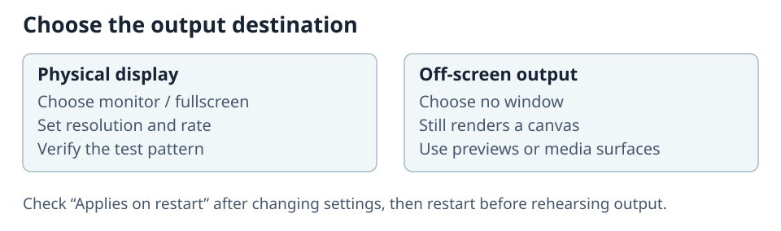

# Configure outputs and displays

Each output has its own picture destination, sound device and DMX input. Pixel starts with one **Main** output. Check every enabled output's physical destination and control address before using it in a show.

## Picture destination

Choose either a physical monitor or an off-screen output. A monitor output stores the exact monitor selector and whether it is fullscreen. Configure the render resolution independently from the desktop's apparent size, then choose the supported presentation mode and frame rate for the destination.

Change **Monitor** in **Settings > Picture** to move a running output without restarting Pixel. The selection is saved for the next launch. On Windows, the Pixel notification-area menu also offers a **Move [output] to Display [number]** action for every connected display.

Use the test pattern after every monitor, cable, resolution, refresh-rate, or fullscreen change. A browser preview proves that the engine rendered a frame; only the physical test pattern proves that the intended display received it.

On Windows, fullscreen picture outputs are borderless, have no title bar or window frame, and stay above other windows on their display. Click a fullscreen output to show its short recovery hint. Double-click the picture, or press **Ctrl + Shift + -**, to return that output to a normal decorated window. Press **Ctrl + Shift + an arrow key** to move the still-fullscreen output to the nearest display in that direction; at the edge of the desktop, the output stays on its current display.

Use [Pixel Map](10-pixel-map.md) to crop display regions and send sampled pixels over Art-Net or sACN. Use [Audio](11-audio.md) to check input analysis and sound output.

## Control personality and DMX

Open **Settings > Network & DMX**. Network and DMX input share one tab because the listen addresses at the top are the transport DMX arrives on. Below them, **DMX input** sets each output's personality, protocol, universe, and start address; the protocol only chooses which of the listeners above feeds that output. Art-Net normally listens on UDP `6454`, sACN on UDP `5568`, and CITP/MSEX on the configured TCP/UDP port, normally `4809`.

Choose **2 layers** (158 slots) or **8 layers** (512 slots). These are the only personalities, and both use the 3D-object-mapping channel layout of 59 slots per layer followed by a 40-slot Master. Each layer has two [effect banks](08-effects-and-masks.md) and four separate [Visualizer Parameter controls](05-generated-sources-and-effects.md#control-a-visualizer-from-a-layer). The master and layer profiles patched in ToskLight Control must match that personality and address. An eight-layer output fills its universe, so it starts at address 1.

If an Art-Net or sACN port is occupied, Pixel keeps its interface available and reports the listener failure in Network settings. Free the port or correct the listen address. The listener retries with the saved address immediately.

For console profiles and network setup, follow [Connect Control](09-connect-the-desk.md) or [Connect another console](12-other-consoles.md).

## Apply settings

Settings save automatically. **Applies on restart** identifies a saved change that the running server has not applied. **Revert to current settings** cancels those pending changes.

| Setting | Takes effect | Check |
| --- | --- | --- |
| Monitor selection | Immediately | The running window moves; the selection also survives restart. |
| Target, fullscreen, resolution, presentation rate | After restart | Check the physical test pattern after restarting. |
| DMX protocol, universe, start address | Immediately | Check the running address on the DMX page. |
| Art-Net, sACN, Speed Group listen addresses | Immediately | Check listener status and the expected sender. |
| Tempo source | Immediately | Confirm Playback BPM or the selected Speed Group. |
| Pixel map | When **Save pixel map** succeeds | Reopen Pixel Map and check the output. |
| Audio gain, automatic gain, beat sensitivity, EQ | Immediately | Watch the Audio meters and instrument lamps. |
| Sound output and audio input device | After restart | Check the selected physical device. |
| Personality | After restart | Confirm the decoder's layer count and console patch. |
| CITP listen address | After restart | Reconnect the console and check library names/previews. |
| Interface HTTP address | After restart | Open the newly configured address. |
| Media library directory | After restart | Check the selected library and its content. |
| Clip switch hold, In/Out frame rate, server time | Immediately | Check the next content change, range or clock. |

**Light and Media are on this computer** moves Art-Net, sACN and Speed Group listeners immediately; CITP and HTTP follow after restart. Choosing another configuration and media folder restarts Pixel automatically. Playback, layer, Master and takeover changes apply immediately.

Additional outputs share the computer's resources. Rehearse each display, resolution, presentation rate, audio path, DMX footprint and preview identity under the intended load.
