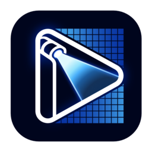

# ToskLight Pixel

Pixel plays video, images and text, generates moving visuals, and applies effects. Its output can feed a screen or projector, or sample picture regions for pixel fixtures. Use Control to record and run media alongside lighting Cues.

Pixel has a browser interface for preparing the library and configuring outputs. Program-output windows carry the picture to the displays. Pixel's generated **Visualizers** are media sources; Control and Architect's lighting **Visualizer** shows the rig and its light.

Start with a known image on one output, then connect Control:

1. [Start Pixel and check the output](01-quick-start.md): open the browser interface, test the display and locate portable server data.
2. [Configure outputs and displays](03-outputs-and-displays.md): choose destinations, DMX personality and settings that need restart.
3. [Prepare the media library](02-library-and-uploads.md): upload addressed content and manage conversions, thumbnails and notes.
4. [Operate layers and the master](04-playback-and-layers.md): take over, audition content, set playback ranges and return control to the desk.
5. [Connect Control to Pixel](09-connect-the-desk.md): discover or patch the output, recall media in Cues and check DMX and previews.

For a particular task:

- [Create generated visuals](05-generated-sources-and-effects.md): tune motion and audio response, including the four layer parameter controls.
- [Show text, clocks and countdowns](07-text-and-countdowns.md): prepare addressed lettering and set venue time.
- [Apply effects and masks](08-effects-and-masks.md): prepare presets and play them in the two ordered layer banks.
- [Map a layer onto a 3D model](06-3d-model-mapping.md): choose a built-in object or import a UV-mapped GLB.
- [Map display regions and pixels](10-pixel-map.md): crop display regions and patch pixel zones.
- [Set up audio](11-audio.md): check the analysis input, instrument detection and sound output.
- [Connect another console](12-other-consoles.md): download Layer/Master profiles and configure DMX and CITP.
